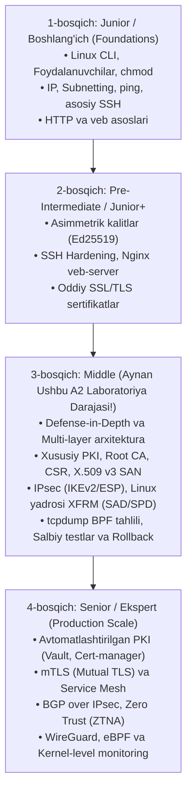

# A2 Amaliy Mashg‘uloti: Tahlil, Bajarilish Jarayoni va Yakuniy Xulosa

Ushbu hujjat `description.md` va `TX_A2_1_variant_batafsil.pdf` materiallari asosida tayyorlangan bo‘lib, laboratoriya ishining konseptual maqsadi, qo‘llanilgan barcha vositalar va CLI buyruqlar tahlili, ushbu bilimlarni o‘rganish bosqichlari hamda mustaqil ta’lim uchun tavsiyalarni o‘z ichiga oladi.

---

## 1. Vazifani Bajarishdan Asosiy Maqsad

Laboratoriya ishining tub maqsadi — ikki mustaqil operatsion tizim (**Ubuntu Server 24.04 LTS**) o‘rtasida **"Ko‘p qatlamli himoya" (Defense-in-Depth)** tamoyiliga asoslangan, xavfsiz va shifrlangan aloqa kanalini amalda barpo etishdir.

### 1.1. Konseptual va fundamental maqsadlar
1. **OSI va TCP/IP modelining turli qatlamlarida xavfsizlikni ta’minlash:**
   Tarmoq xavfsizligida faqat birgina himoya vositasiga (masalan, faqat parolli SSH yoki faqat veb-shifrlashga) tayanib qolish xavflidir. Agar bir qatlam buzilsa, keyingi qatlam ma’lumotlar yaxlitligi va maxfiyligini saqlab qolishi shart. Ushbu mashg‘ulotda 3 xil fundamental protokol bir vaqtning o‘zida birlashtirildi:
   * **SSH (Secure Shell) — 7-qatlam (Ilova / Amaliy qatlam):** Serverni masofadan boshqarish terminali trafigini (TCP 22) himoyalash.
   * **TLS (Transport Layer Security) — 4–7-qatlamlar oralig‘i:** Veb-ilovalar va foydalanuvchi ma’lumotlari oqimini (HTTPS, TCP 443) himoyalash.
   * **IPsec (Internet Protocol Security) — 3-qatlam (Tarmoq qatlami):** Ikki tizim o‘rtasidagi butun IP paketlar yuklamasini (payload) operatsion tizim yadrosi (kernel) darajasida shifrlash.

2. **Parolsiz asimmetrik kriptografiyaga o‘tish:**
   Inson omili bilan bog‘liq bo‘lgan zaif parollar, lug‘at hujumlari (dictionary attacks) va parollarni taxmin qilish (brute-force) xatarlarini yo‘qotish maqsadida SSH uchun zamonaviy **Ed25519** elliptik egri chizig‘iga asoslangan asimmetrik kalitlar tizimi joriy etildi va an’anaviy parolli kirish butunlay taqiqlandi (**Hardening**).

3. **Xususiy PKI (Public Key Infrastructure) va SAN standartlarini o‘zlashtirish:**
   Ommaviy tijoriy sertifikatlash markazlariga qaram bo‘lmagan holda, ichki infratuzilma uchun xususiy **Lokal Ildiz Sertifikatlash Markazini (Root CA)** noldan yaratish, X.509 v3 standartidagi zamonaviy **SAN (Subject Alternative Name)** maydoniga ega sertifikat ishlab chiqish va mijoz tizimida **Ishonch Zanjiri (Chain of Trust)** mexanizmini to‘g‘ri o‘rnatish.

4. **Nazoratli salbiy (Controlled Negative) sinovlar madaniyatini shakllantirish:**
   Xavfsizlik tizimi faqatgina "to‘g‘ri ma’lumot berilganda ishlashi" (ijobiy sinov) bilan emas, balki "noto‘g‘ri yoki begona so‘rov kelganda uni qat’iy rad eta olishi" (salbiy sinov) bilan baholanadi. Shu maqsadda:
   * Parol orqali kirish urinishi bloklanishi (`Permission denied (publickey)`);
   * Soxta yoki mos kelmaydigan domen nomi orqali HTTPS ga ulanish rad etilishi (`SSL: certificate subject name does not match target host name`);
   * Noto‘g‘ri PSK kaliti kiritilganda IPsec tunnel o‘rnatilmasligi (`AUTHENTICATION_FAILED`) amalda sinab ko‘rildi.

5. **Paketlar va Yadro darajasida tahlil qilish (Forensic & Kernel Analysis):**
   Shifrlash faqat dasturiy ta’minot oynasida emas, balki Linux yadrosining **XFRM (Transform)** quyi tizimida (`SAD` va `SPD` jadvallari) va `tcpdump` orqali tarmoq simida **ESP (Encapsulating Security Payload, IP protokol 50)** ko‘rinishida o‘tayotganini ilmiy-amaliy jihatdan isbotlash.

---

## 2. Foydalanilgan Tashqi Kutubxonalar va Qo‘shimcha Tool'lar

Ushbu laboratoriya ishi butunlay zamonaviy, ochiq manbali (Open-Source) va xalqaro sanoat standartlariga (RFC) javob beruvchi vositalarga tayangan:

| № | Dasturiy ta’minot / Paket | Ishlatilgan VM / Qatlam | Asosiy vazifasi va nima uchun tanlangani |
|---|---|---|---|
| **1** | **VMware Workstation Pro / Player (`vmware-netcfg`)** | Host tizimi (Ubuntu) | L2 darajasida tashqi Wi-Fi dan mutlaqo izolyatsiyalangan shaxsiy virtual tarmoq (`vmnet2`, `192.168.57.0/24`) yaratish va VMlar o‘rtasida toza laboratoriya muhitini ta’minlash. |
| **2** | **OpenSSH (`openssh-client`, `openssh-server`)** | Ikkala VMda (CLIENT-1 / SRV-1) | Masofaviy boshqaruv, `ssh-keygen` orqali Ed25519 kalit juftligini yaratish, `ssh-copy-id` orqali ochiq kalitni uzatish, `scp` orqali CA sertifikatini ko‘chirish va `sshd` konfiguratsiyasini xavfsizlashtirish (Hardening). |
| **3** | **OpenSSL (`openssl`)** | Ikkala VMda | Kriptografik operatsiyalar: 3072-bitli RSA Lokal CA yaratish, 2048-bitli CSR va X.509 v3 SAN sertifikatini imzolash, ishonch zanjirini tekshirish (`verify`) hamda TLS sessiyasini chuqur tahlil qilish (`s_client`). |
| **4** | **Nginx (`nginx`)** | Faqat SRV-1 da | Yuqori tezlikda ishlovchi veb-server; faqat xavfsiz **TLS 1.2** va **TLS 1.3** protokollarini yoqib, HTTPS xizmatini taqdim etish. |
| **5** | **cURL (`curl`)** | Faqat CLIENT-1 da | Terminal orqali HTTPS so‘rovlarini bajarish, maxsus Lokal CA faylini (`--cacert`) uzatish, hamda DNS ni aldab xato host nomlari bilan negativ testlar o‘tkazish (`--resolve`). |
| **6** | **strongSwan (`strongswan`, `strongswan-starter`)** | Ikkala VMda | Linux tizimida IKEv2 (Internet Key Exchange v2) protokoli asosida IPsec xavfsizlik assotsiatsiyalarini (IKE SA va CHILD SA) o‘rnatish va boshqarish. |
| **7** | **iproute2 to‘plami (`ip`, `ss`)** | Ikkala VMda | Zamonaviy Linux tarmoq boshqaruvi: interfeyslarni boshqarish (`ip link`), statik IP berish (`ip addr`), marshrutlash (`ip route`), ARP tekshiruvi (`ip neigh`), ochiq portlarni monitoring qilish (`ss -lntup`) hamda Linux yadrosi IPsec xavfsizlik jadvallarini (`ip xfrm state/policy`) o‘qish. |
| **8** | **tcpdump (`tcpdump`)** | Ikkala VMda | Tarmoq trafigini past darajali ushlash (packet sniffer); BPF filtrlari orqali ICMP, UDP (500/4500) va ESP (protokol 50) paketlarini ushlab, shifrlashni paketlar sarlavhalari darajasida tekshirish. |
| **9** | **System & Tizim vositalari (`systemctl`, `journalctl`, `sed`, `install`, `chmod`, `cp`)** | Ikkala VMda | Xizmatlarni boshqarish va xavfsiz qayta yuklash (`reload`/`restart`), tizim jurnallaridagi autentifikatsiya xatolarini o‘qish, konfiguratsiyalarni zaxiralash va fayl huquqlarini (600, 700) qat’iy cheklash. |

---

## 3. Ketma-ket Bajarilgan CLI Komandalar, Parametrlari va Maqsadi

Mashg‘ulot davomida bajarilgan har bir buyruq maqsadi va ishlatilgan argumentlari bo‘yicha to‘liq tizimlashtirildi:

### 0-bosqich: Virtual Tarmoq va Paketlarni O‘rnatish
* **Ubuntu Hostda:**
  * `sudo vmware-netcfg`: VMware tarmoq muharririni ochib, DHCP xizmatisiz, faqat host-only rejimida ishlovchi `vmnet2` (`192.168.57.0/24`) tarmog‘ini yaratish.
* **CLIENT-1 da:**
  * `sudo apt update`: Paket indekslarini yangilash.
  * `sudo apt install -y openssh-client openssl curl strongswan tcpdump iproute2`: Mijoz uchun zarur barcha vositalarni bir martalik buyruq bilan o‘rnatish.
* **SRV-1 da:**
  * `sudo apt update`: Paket indekslarini yangilash.
  * `sudo apt install -y openssh-server openssl nginx strongswan tcpdump iproute2`: Server xizmatlari va vositalarini o‘rnatish.
  * `sudo systemctl enable --now ssh nginx strongswan-starter`: SSH, Nginx va strongSwan xizmatlarini tizim yuklanishiga qo‘shish va darhol ishga tushirish.

---

### 1-bosqich: Virtual Tarmoq va Statik IP Manzillarni Sozlash (A2-LAB: 192.168.57.0/24)
* **Ikkala VMda:**
  * `ip -br link`: Tarmoq interfeyslari ro‘yxatini ixcham jadvalda ko‘rish (ikkinchi interfeys nomini, masalan, `ens37` ni aniqlash).
* **CLIENT-1 da:**
  * `LAB_IF=ens37`: Interfeys nomini qulaylik uchun o‘zgaruvchiga olish.
  * `sudo ip link set "$LAB_IF" up`: Interfeysning fizik/mantiqiy aloqasini faollashtirish (UP holatga keltirish).
  * `sudo ip addr flush dev "$LAB_IF"`: Interfeysdagi barcha eski yoki adashib olingan dinamik IP manzillarni tozalash.
  * `sudo ip addr add 192.168.57.10/24 dev "$LAB_IF"`: CLIENT-1 ga statik `192.168.57.10` IP manzilini va `/24` niqobini biriktirish.
  * `ip -br addr show "$LAB_IF"`: IP manzil to‘g‘ri o‘tirganini tasdiqlash.
  * `ip route get 192.168.57.20`: Kernel `192.168.57.20` ga paket jo‘natishda qaysi interfeysdan chiqishini oldindan tekshirish.
* **SRV-1 da:**
  * `LAB_IF=ens37 && sudo ip link set "$LAB_IF" up && sudo ip addr flush dev "$LAB_IF"`: Interfeysni tayyorlash.
  * `sudo ip addr add 192.168.57.20/24 dev "$LAB_IF"`: Serverga statik `192.168.57.20` manzilini berish.
  * `sudo ss -lntup | grep -E ':(22|443)\b'`: Tizimda SSH (22) va veb (443) portlari tinglanayotganini tahlil qilish (`-l` tinglovchi, `-n` sonli format, `-t` TCP, `-u` UDP, `-p` dastur nomi).
* **Bazaviy aloqa tekshiruvi (CLIENT-1 dan):**
  * `ping -c 3 192.168.57.20`: SRV-1 serveriga 3 ta ICMP paketi yuborib, L3 aloqani tekshirish.
  * `ip neigh show 192.168.57.20`: ARP keshini tekshirish (L2 MAC manzil aniqlanganini va holat `REACHABLE` ekanini ko‘rish).

---

### 2-bosqich: SSH ni ED25519 Kaliti Bilan Sozlash va Hardening
* **CLIENT-1 da kalit yaratish va uzatish:**
  * `mkdir -p ~/.ssh && chmod 700 ~/.ssh`: Shaxsiy SSH katalogini xavfsiz huquqlar bilan yaratish.
  * `ssh-keygen -t ed25519 -a 64 -f ~/.ssh/a2_ed25519`: 64 ta KDF raundiga ega zamonaviy Ed25519 asimmetrik kalit juftligini (`a2_ed25519` maxfiy kalit va `a2_ed25519.pub` ochiq kalit) yaratish.
  * `ssh-copy-id -i ~/.ssh/a2_ed25519.pub student@192.168.57.20`: Ochiq kalitni serverdagi `authorized_keys` fayliga xavfsiz yozish.
  * `ssh -i ~/.ssh/a2_ed25519 student@192.168.57.20 'hostname; whoami'`: Kalit orqali dastlabki parolsiz kirishni tekshirish.
* **SRV-1 da SSH Hardening:**
  * `sudo cp -a /etc/ssh/sshd_config /etc/ssh/sshd_config.a2-backup`: Standart sozlamani to‘liq atributlari bilan zaxiralash.
  * `/etc/ssh/sshd_config.d/99-a2-hardening.conf` fayliga qat’iy qoidalar kiritish:
    - `PermitRootLogin no`: Root foydalanuvchiga to‘g‘ridan-to‘g‘ri SSH orqali kirishni taqiqlash.
    - `PubkeyAuthentication yes`: Faqat ochiq kalit bilan kirishga ruxsat berish.
    - `PasswordAuthentication no`: Parolli kirishni butunlay bekor qilish.
    - `KbdInteractiveAuthentication no`: Klaviatura orqali interaktiv so‘rovlarni to‘xtatish.
    - `MaxAuthTries 3`: Bitta sessiyadagi xato urinishlar sonini 3 tagacha cheklash.
    - `AllowUsers student`: Serverga faqat `student` hisobidan kirishga ruxsat berish.
  * `sudo sshd -t`: SSH konfiguratsiyasining sintaksisini sinash (xatolik bo‘lsa serverdan uzilib qolmaslik uchun).
  * `sudo sshd -T | grep -E '^(permitrootlogin|pubkeyauthentication|passwordauthentication|kbdinteractiveauthentication|maxauthtries|allowusers)'`: Yangi qoidalar faollashganini tekshirish.
  * `sudo systemctl reload ssh`: Xizmatni uzmasdan konfiguratsiyani qayta yuklash.
* **SSH Sinovlari (CLIENT-1 da):**
  * *Ijobiy sinov:* `ssh -i ~/.ssh/a2_ed25519 student@192.168.57.20 'echo SSH_KEY_OK'` — kalit orqali muvaffaqiyatli kirish.
  * *Nazoratli salbiy sinov:* `ssh -o PubkeyAuthentication=no -o PreferredAuthentications=password student@192.168.57.20` — kalitni majburiy o‘chirib, parol bilan kirishga urinish. Natijada `Permission denied (publickey)` chiqib, server parollarni qabul qilmayotgani isbotlandi.

---

### 3-bosqich: Lokal CA va TLS Server Sertifikatini Yaratish (SAN bilan)
Ushbu bosqich SRV-1 da bajariladi:
* `sudo install -d -m 700 /etc/a2-tls && cd /etc/a2-tls`: Sertifikatlar uchun faqat root kirishi mumkin bo‘lgan yopiq katalog ochish.
* `sudo openssl genpkey -algorithm RSA -pkeyopt rsa_keygen_bits:3072 -out ca.key`: CA uchun 3072-bitli mustahkam RSA maxfiy kalitini hosil qilish.
* `sudo openssl req -x509 -new -sha256 -days 365 -key ca.key -out ca.crt -subj "/C=UZ/O=A2 Lab/CN=A2 Lab CA"`: 1 yilga mo‘ljallangan, o‘zini o‘zi imzolagan Lokal Ildiz CA sertifikatini yaratish.
* `sudo openssl genpkey -algorithm RSA -pkeyopt rsa_keygen_bits:2048 -out srv1.key`: Nginx serveri uchun 2048-bitli RSA maxfiy kalitini yaratish.
* `sudo openssl req -new -key srv1.key -out srv1.csr -subj "/C=UZ/O=A2 Lab/CN=srv1.a2.lab"`: Server uchun sertifikat imzolash so‘rovini (CSR) yaratish.
* `/etc/a2-tls/srv1.ext` faylini yaratish: Unda `basicConstraints=CA:FALSE`, `keyUsage=digitalSignature,keyEncipherment`, `extendedKeyUsage=serverAuth` va eng muhimi `subjectAltName=DNS:srv1.a2.lab,IP:192.168.57.20` parametrlarini belgilash.
* `sudo openssl x509 -req -in srv1.csr -CA ca.crt -CAkey ca.key -CAcreateserial -out srv1.crt -days 120 -sha256 -extfile srv1.ext`: Server sertifikatini CA orqali SAN kengaytmalari bilan 120 kunga imzolash.
* `sudo chmod 600 ca.key srv1.key && sudo chmod 644 ca.crt srv1.crt`: Maxfiy kalitlarni `600` huquqi bilan yashirish, ochiq sertifikatlarga `644` berish.
* `sudo install -o student -g student -m 644 ca.crt /home/student/a2-ca.crt`: CA sertifikatini mijoz ko‘chirib olishi uchun `student` katalogiga nusxalash.
* **Sertifikat tekshiruvlari:**
  * `sudo openssl verify -CAfile ca.crt srv1.crt`: Ishonch zanjirini tekshirish (natija: `srv1.crt: OK`).
  * `sudo openssl x509 -in srv1.crt -noout -subject -issuer -dates -ext subjectAltName`: Sertifikat egasi, beruvchi CA, muddati va SAN maydonini to‘liq ko‘zdan kechirish.

---

### 4-bosqich: Nginx da TLS 1.2/1.3 HTTPS Xizmati va Sinovlar
* **SRV-1 da Nginx sozlash:**
  * `/etc/nginx/sites-available/a2-tls` faylida server blokini yaratish:
    - `listen 443 ssl;`
    - `server_name srv1.a2.lab;`
    - `ssl_certificate /etc/a2-tls/srv1.crt;`
    - `ssl_certificate_key /etc/a2-tls/srv1.key;`
    - `ssl_protocols TLSv1.2 TLSv1.3;` (eski zaif SSLv3, TLS 1.0, 1.1 taqiqlanadi).
  * `sudo ln -sfn /etc/nginx/sites-available/a2-tls /etc/nginx/sites-enabled/a2-tls`: Saytni faollashtirish.
  * `sudo nginx -t`: Nginx sintaksisini tekshirish.
  * `sudo systemctl reload nginx`: Nginx ni uzilishlarsiz qayta yuklash.
  * `sudo ss -lntp | grep ':443'`: 443-port tinglanayotganini tekshirish.
* **CLIENT-1 da sozlash va sinovlar:**
  * `echo '192.168.57.20 srv1.a2.lab' | sudo tee -a /etc/hosts`: DNS bo‘lmagani sababli lokal `/etc/hosts` orqali IP va nomni bog‘lash.
  * `scp -i ~/.ssh/a2_ed25519 student@192.168.57.20:~/a2-ca.crt ~/a2-ca.crt`: CA sertifikatini serverdan shifrlangan kanal orqali yuklab olish.
  * `openssl x509 -in ~/a2-ca.crt -noout -subject -fingerprint -sha256`: CA ning yaxlitligini tekshirish.
  * *Ijobiy sinov:* `curl --cacert ~/a2-ca.crt https://srv1.a2.lab/` — natijada `A2 TLS service is working` matni olinadi.
  * *Sessiya diagnostikasi:* `openssl s_client -connect 192.168.57.20:443 -servername srv1.a2.lab -CAfile ~/a2-ca.crt </dev/null 2>/dev/null | grep -E 'Protocol|Cipher|Verify return code'` — protokol (TLSv1.3), shifr to‘plami (masalan, `TLS_AES_256_GCM_SHA384`) va `Verify return code: 0 (ok)` tasdiqlanadi.
  * *Nazoratli salbiy sinov:* `curl --resolve wrong.a2.lab:443:192.168.57.20 --cacert ~/a2-ca.crt https://wrong.a2.lab/` — domen nomi SAN ga mos kelmagani uchun cURL `SSL: certificate subject name 'srv1.a2.lab' does not match target host name 'wrong.a2.lab'` xatosi bilan so‘rovni to‘xtatadi.

---

### 5-bosqich: strongSwan orqali IKEv2/IPsec Transport Rejimini Sozlash
* **Ikkala VMda (CLIENT-1 va SRV-1):**
  * `sudo cp -a /etc/ipsec.conf /etc/ipsec.conf.a2-backup` va `sudo cp -a /etc/ipsec.secrets /etc/ipsec.secrets.a2-backup`: Konfiguratsiyalarni zaxiralash.
  * `/etc/ipsec.conf` fayliga quyidagi transport rejimini yozish:
    - `keyexchange=ikev2`: Xavfsiz IKEv2 almashinuvi.
    - `type=transport`: Butun paket emas, faqat L4 yuklamani shifrlash (L3 IP sarlavha saqlanadi).
    - `authby=psk`: Pre-Shared Key orqali autentifikatsiya.
    - `left=192.168.57.10` va `right=192.168.57.20`: Tengdoshlarning IP manzillari.
    - `ike=aes256-sha256-modp2048!`: 1-faza IKE SA kriptografik to‘plami (AES-256, SHA-256, DH guruhi 14).
    - `esp=aes256-sha256!`: 2-faza CHILD SA ma’lumotlarni shifrlash to‘plami.
    - `auto=start`: Xizmat ko‘tarilganda avtomatik ulanishga urinish.
  * `/etc/ipsec.secrets` fayliga umumiy laboratoriya maxfiy kalitini yozish:
    `192.168.57.10 192.168.57.20 : PSK "A2-Lab-Only-Change-2026!"`
  * `sudo chmod 600 /etc/ipsec.secrets`: strongSwan talabiga ko‘ra PSK faylini boshqalardan himoyalash.
  * `sudo ipsec restart`: strongSwan demonini yangi parametrlar bilan qayta ishga tushirish.
  * `sudo ipsec statusall`: Servis va mavjud konfiguratsiyalar holatini ko‘rish.
* **Tunnelni faollashtirish (CLIENT-1 dan):**
  * `sudo ipsec up a2-host-to-host`: Ulanishni ko‘tarish (IKEv2 handshake boshlanadi va muvaffaqiyatli yakunlanadi).
  * `ping -c 4 192.168.57.20`: Tunnel orqali aloqani sinash.
  * `sudo ipsec statusall`: Unda `ESTABLISHED` (IKE SA) va `INSTALLED, TRANSPORT` (CHILD SA) holatlari qayd etiladi.

---

### 6-bosqich: IPsec SA, Linux XFRM Siyosati va tcpdump Tahlili
* **Linux yadrosi XFRM quyi tizimini ko‘rish (ikkala VMda):**
  * `sudo ip xfrm state`: Linux yadrosining **SAD (Security Association Database)** jadvalini ko‘rsatadi (har bir yo‘nalish uchun alohida SPI raqami, AES shifrlash algoritmi va yadro darajasidagi simmetrik kalitlar ko‘rinadi).
  * `sudo ip xfrm policy`: Linux yadrosining **SPD (Security Policy Database)** jadvalini chiqaradi (`src 192.168.57.10 dst 192.168.57.20 ... proto esp mode transport` qoidasi kernelga barcha paketlarni ESP da shifrlashni buyuradi).
* **tcpdump orqali ESP paketlarini tutish:**
  * SRV-1 da: `sudo tcpdump -ni ens37 'esp or udp port 500 or udp port 4500' -c 10`: BPF filtri orqali faqat ESP va IKEv2 paketlarini 10 ta dona ushlab to‘xtash.
  * CLIENT-1 da: `ping -c 6 192.168.57.20` va `curl --cacert ~/a2-ca.crt https://srv1.a2.lab/` orqali trafik jo‘natish.
  * *Natija:* `tcpdump` oynasida oddiy `ICMP Echo` yoki `HTTP GET` o‘rniga toza `IP 192.168.57.10 > 192.168.57.20: ESP(spi=0x..., seq=...)` paketlari qayd etiladi. Bu shifrlash L3 da to‘liq ishlayotganini isbotlaydi.

---

### 7-bosqich: Nazoratli Xatolik Sinovi (Noto‘g‘ri PSK) va Rollback
* **CLIENT-1 da ataylab xatolik hosil qilish:**
  * `sudo cp -a /etc/ipsec.secrets /etc/ipsec.secrets.a2-ok`: Ishchi fayldan zaxira nusxa olish.
  * `sudo ipsec down a2-host-to-host`: Ishlab turgan tunnelni uzish.
  * `sudo sed -i 's/A2-Lab-Only-Change-2026!/A2-Wrong-PSK-2026!/' /etc/ipsec.secrets`: `sed` yordamida parolni ataylab noto‘g‘ri qiymatga almashtirish.
  * `sudo ipsec restart && sudo ipsec up a2-host-to-host`: Tunnelni ko‘tarishga urinish (Natijada autentifikatsiya rad etiladi: `received AUTHENTICATION_FAILED notify error`).
  * `sudo journalctl -u strongswan-starter -n 30 --no-pager`: Tizim jurnalida IKEv2 autentifikatsiya xatosini qayd etish.
* **Tizimni dastlabki holatiga qaytarish (Rollback):**
  * `sudo cp -a /etc/ipsec.secrets.a2-ok /etc/ipsec.secrets`: To‘g‘ri faylni joyiga qaytarish.
  * `sudo chmod 600 /etc/ipsec.secrets`: Ruxsatlarni tiklash.
  * `sudo ipsec restart && sudo ipsec up a2-host-to-host`: Tunnelni qayta tiklash.
  * `sudo ipsec statusall`: Tunnel yana `INSTALLED` holatga qaytganini tasdiqlash.

---

### 8-bosqich: Yakuniy Ko‘p Qatlamli Integratsion Tekshiruv
Tunnel ishlab turgan holatda yuqori qatlam xizmatlarining uzluksizligi sinovdan o‘tkazildi:
* `ssh -i ~/.ssh/a2_ed25519 student@192.168.57.20 'echo SSH_OVER_IPSEC_OK'`: SSH sessiyasi IPsec ichidan muvaffaqiyatli o‘tdi.
* `curl --cacert ~/a2-ca.crt https://srv1.a2.lab/`: HTTPS sessiyasi IPsec ichidan muvaffaqiyatli o‘tdi.
* `sudo ipsec statusall && sudo ip xfrm policy`: IPsec hamon faol ekanligi tasdiqlandi.

---

## 4. Mustaqil Ta’lim (Self-Study): Bu Bilimlarni Qaysi Bosqich / Darajaga Yetganda O‘rganish Kerak?

Ushbu laboratoriya ishida bajarilgan vazifalar IT va Axborot xavfsizligi sohasida qayerda turishi va o‘rganuvchi qaysi darajaga yetganda ushbu mavzularni chuqurlashtirishi kerakligining tahlili:



### 4.1. Kasbiy yo‘nalishlar va mutaxassislik darajalari kesimida:
1. **Linux Tizim Administratori (Junior-to-Mid System Administrator):**
   * *Qachon o‘rganish kerak:* Linux tizimlarida fayllar, foydalanuvchilar, huquqlar va paketlar bilan ishlashni to‘liq o‘zlashtirgandan so‘ng.
   * *Nima uchun kerak:* Ishlab chiqarish muhitida hech bir server parolli SSH bilan qoldirilmaydi. Nginx da TLS 1.3 sozlash va o‘zaro xavfsiz VPN kanallari (IPsec) qurish korporativ tarmoq administratorining kundalik standart talabidir.
2. **Tarmoq Xavfsizligi Muhandisi (Network Security Engineer / SOC Analyst):**
   * *Qachon o‘rganish kerak:* CCNA (Cisco Certified Network Associate) yoki CompTIA Network+ / Security+ darajasidagi bazaviy tarmoq nazariyasi (OSI 7 qatlam, TCP handshake, IP sarlavhalari) o‘zlashtirilgan zahoti.
   * *Nima uchun kerak:* Xavfsizlik bo‘yicha tahlilchi (SOC Analyst) shunchaki ekrandagi xabarlarni emas, balki `tcpdump` va Wireshark orqali paketlar ichida nima bo‘layotganini, ESP protokoli (50) va IKEv2 (UDP 500) qanday ko‘rinishini, sertifikatdagi SAN nomutanosibligi qanday hujumlardan asrashini chuqur tushunishi shart.
3. **DevSecOps va Cloud Security Muhandisi (Mid Level):**
   * *Qachon o‘rganish kerak:* Docker, Kubernetes yoki bulutli tizimlar (AWS, GCP, Azure) o‘rtasida xavfsiz shifrlangan tarmoq aloqalarini (Site-to-Site yoki Host-to-Host) loyihalashdan oldin.
   * *Nima uchun kerak:* Bulutda virtual serverlar orasidagi aloqani IPsec yoki TLS orqali shifrlash, serverlararo mikroservis muloqotini himoyalashning poydevori hisoblanadi.

---

## 5. Antigravity AI Maslahatlari va Shaxsiy Tavsiyalar

Agar siz ushbu yo‘nalishda mustaqil ravishda (self-study) o‘z mahoratingizni professional darajaga ko‘tarmoqchi bo‘lsangiz, quyidagi tamoyillarga amal qilishingizni maslahat beraman:

### 1. "Nusxalab tashlash" (Copy-Paste) tuzog‘iga tushmang
Hech qachon internetdan yoki qo‘llanmalardan buyruqlarni ko‘r-ko‘rona nusxalamang. Har bir buyruqning har bir argumentini tahlil qiling:
* Masalan: Nima uchun `ssh-keygen -a 64`? (Chunki standart 16 raund o‘rniga 64 ta KDF qo‘llanilsa, parolli maxfiy kalitni GPU orqali brute-force qilish ancha qiyinlashadi).
* Nima uchun `type=transport` va `type=tunnel` emas? (Chunki ikki bitta host o‘rtasida qo‘shimcha IP sarlavhasisiz faqat yuklamani shifrlash kifoya).
Doimo tizimdagi rasmiy qo‘llanmalarni o‘qing: `man sshd_config`, `man ip-xfrm`, `man openssl-req`.

### 2. "Controlled Negative Testing" fikrlash tarzini shakllantiring
Tajribasiz mutaxassis faqat "Tizim ishga tushdimi?" deb tekshiradi. Professional xavfsizlik muhandisi esa "Tizim ruxsat berilmagan so‘rovlarni to‘g‘ri rad etyaptimi?" deb tekshiradi:
* Noto‘g‘ri parol kiriting — server rad etishi kerak.
* Noto‘g‘ri domen bilan HTTPS ga ulaning — cURL xato berishi kerak.
* Noto‘g‘ri PSK bering — tunnel ko‘tarilmasligi kerak.
Bu yondashuv sizni haqiqiy audit va penetratsion sinovlarga tayyorlaydi.

### 3. Linux yadrosi (Kernel internals) bilan do‘stlashing
Ko‘pchilik IPsec deganda faqat strongSwan dasturini tushunadi. Aslida strongSwan faqat kalit almashuvchi (IKEv2 demoni) xolos! Haqiqiy shifrlash va paketlarni ESP ga o‘rashni **Linux yadrosining XFRM moduli** bajaradi. `ip xfrm state` va `ip xfrm policy` ni tushunadigan mutaxassis har doim oddiy tizim ma’muridan bir bosh ustun turadi.

### 4. Zaxiralash (Backup) va Tiklash (Rollback) madaniyati
Haqiqiy korporativ tizimlarda birgina xato sozlama tufayli yuzlab serverlar tarmoqdan uzilib qolishi mumkin. Har qanday konfiguratsiya fayliga teginishdan oldin:
```bash
sudo cp -a fayl fayl.bak
```
qilishni va nosozlik bo‘lsa bir necha soniyada xizmatni avvalgi ishchi holatiga qaytarishni o‘zingizga odat qiling.

### 5. Keyingi amaliy qadamlar (Loyihani boyitish uchun):
* **Wireshark GUI tahlili:** `tcpdump -w traffic.pcap` orqali paketlarni faylga yozib olib, Wireshark dasturida oching va ESP sarlavhasi, IKEv2 almashinuv bosqichlarini vizual ko‘ring.
* **mTLS (Mutual TLS):** Mijoz ham serverga o‘z sertifikatini ko‘rsatadigan ikki tomonlama TLS autentifikatsiyasini sinab ko‘ring.
* **Avtomatlashtirish (Ansible):** Ushbu butun laboratoriyani (SSH hardening, CA yaratish, Nginx va strongSwan o‘rnatish) bitta Ansible Playbook orqali to‘liq avtomatlashtiring. Bu sizning rezyumeingiz (CV) uchun ajoyib real loyiha bo‘ladi.
