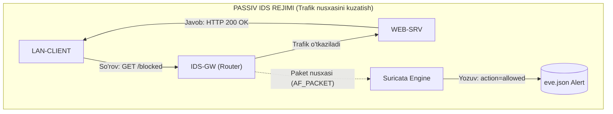
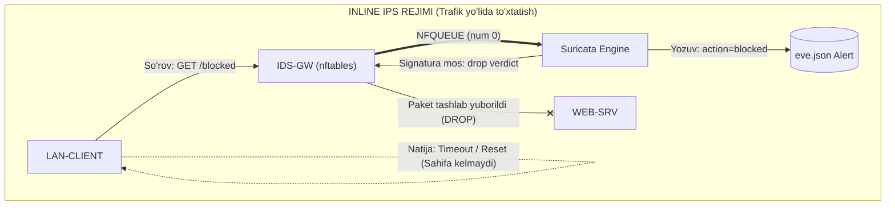
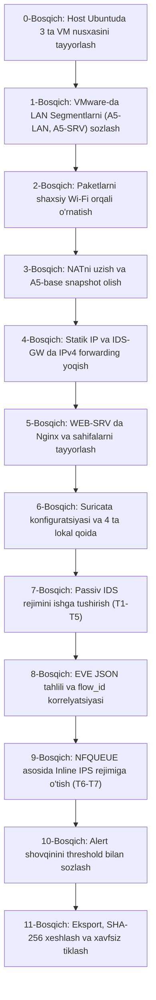

# A5: IDS/IPS Tizimlarini O‘rnatish va Hodisalarni Tahlil Qilish
**Fan:** Tarmoq xavfsizligi (5-semestr) • **Variant:** 1-variant  
**Mavzu:** Suricata IDS ogohlantirishlarini tahlil qilish va NFQUEUE asosida IPS bloklash  
**Muhit:** **Ubuntu Linux Host** $\rightarrow$ **VMware Workstation for Linux** $\rightarrow$ **3 ta Ubuntu Server 24.04 VM**  
*(Shaxsiy lokal Wi-Fi / To‘g‘ridan-to‘g‘ri internet, universitet proksisisiz va Windows-spetsifik cheklovlarsiz)*

---

> [!IMPORTANT]
> **LABORATORIYA ISHINING AMALDAGI ISHCHI MUHITI VA SHARTLARI:**  
> 1. **Host operatsion tizimi:** Windows emas, **Ubuntu Linux** (Desktop)! Windows buyruqlari (`Win+E`, `D:\...`, PowerShell) ishlatilmaydi. Barcha amallar Linux terminali va bash buyruqlari orqali bajariladi.  
> 2. **Virtualizatsiya platformasi:** VMware Workstation (yoki VMware Player) for Linux.  
> 3. **Virtual mashinalar (3 ta mustaqil Ubuntu Server 24.04 VM):**  
>    - **`IDS-GW`** — Router va Suricata Sensor vazifasini bajaruvchi shlyuz (2 ta tarmoq kartasi bilan);  
>    - **`LAN-CLIENT`** — Ichki tarmoqdagi mijoz (hujumchi va oddiy foydalanuvchi simulyatori);  
>    - **`WEB-SRV`** — Himoyalanuvchi veb-server (Nginx xizmati bilan).  
> 4. **Internetga ulanish:** Universitet Wi-Fi yoki proksisi (`172.18.1.1:2500`) **emas**, talabaning **shaxsiy lokal Wi-Fi** tarmog‘i. Shu sababli `export http_proxy`, `/etc/apt/apt.conf.d/99proxy` kabi proksi sozlamalari **umuman talab qilinmaydi**! Paketlar to‘g‘ridan-to‘g‘ri internetdan yuklanadi.  
> 5. **Fayllar almashinuvi:** Windows UNC tarmoq papkasi (`\\172.18.233.234\files`) emas, lokal kataloglar (`~/A5-LAB/`) va Linux `p7zip` arxivatori qo‘llaniladi.  
> 6. **Barcha CLI buyruqlar:** Har bir buyruqning vazifasi, argumentlari va bajarayotgan ishi qadamma-qadam batafsil tushuntirib berilgan.

---

## MUNDARIJA
1. [1-BO‘LIM: Mavzuning maqsadi, vazifalari va kutiladigan natijalar](#1-bolim-mavzuning-maqsadi-vazifalari-va-kutiladigan-natijalar)
   - [1.1. Mashg‘ulot maqsadi va amaliy mohiyati](#11-mashgulot-maqsadi-va-amaliy-mohiyati)
   - [1.2. IDS (Detection) va IPS (Prevention) fundamental farqi](#12-ids-detection-va-ips-prevention-fundamental-farqi)
   - [1.3. Kutiladigan natijalar va laboratoriya ko‘rsatkichlari](#13-kutiladigan-natijalar-va-laboratoriya-korsatkichlari)
2. [2-BO‘LIM: Mavzular bo‘yicha to‘liq nazariy va texnik qo‘llanma](#2-bolim-mavzular-boyicha-toliq-nazariy-va-texnik-qollanma)
   - [2.1. NIDS va NIPS arxitekturasi: Passiv kuzatuv va Inline to‘xtatish](#21-nids-va-nips-arxitekturasi-passiv-kuzatuv-va-inline-toxtatish)
   - [2.2. Suricata dvigateli: Ko‘p oqimli arxitektura va AF_PACKET rejimi](#22-suricata-dvigateli-kop-oqimli-arxitektura-va-af_packet-rejimi)
   - [2.3. Suricata signaturalari (Qoidalari) tuzilishi va sintaksisi](#23-suricata-signaturalari-qoidalari-tuzilishi-va-sintaksisi)
   - [2.4. Linux Netfilter, nftables va NFQUEUE inline mexanizmi](#24-linux-netfilter-nftables-va-nfqueue-inline-mexanizmi)
   - [2.5. EVE JSON jurnallash tizimi va flow_id orqali korrelyatsiya](#25-eve-json-jurnallash-tizimi-va-flow_id-orqali-korrelyatsiya)
   - [2.6. Alert shovqini (Noise) va Thresholding yordamida qoidalarni sozlash (Tuning)](#26-alert-shovqini-noise-va-thresholding-yordamida-qoidalarni-sozlash-tuning)
   - [2.7. Ikki segmentli router-sensor arxitekturasi (IPv4 Forwarding)](#27-ikki-segmentli-router-sensor-arxitekturasi-ipv4-forwarding)
   - [2.8. Shaxsiy Wi-Fi va VMware for Linux sharoitida to‘g‘ridan-to‘g‘ri ishlash](#28-shaxsiy-wi-fi-va-vmware-for-linux-sharoitida-togridan-togri-ishlash)
3. [3-BO‘LIM: Mashqni bajarish ketma-ketligi va Barcha CLI buyruqlarining batafsil tahlili](#3-bolim-mashqni-bajarish-ketma-ketligi-va-barcha-cli-buyruqlarining-batafsil-tahlili)
   - [0-Bosqich: Host Ubuntuda muhitni tayyorlash va 3 ta VM nusxasini ajratish](#0-bosqich-host-ubuntuda-muhitni-tayyorlash-va-3-ta-vm-nusxasini-ajratish)
   - [1-Bosqich: VMware Workstation for Linux-da tarmoq segmentlarini sozlash](#1-bosqich-vmware-workstation-for-linux-da-tarmoq-segmentlarini-sozlash)
   - [2-Bosqich: Shaxsiy Wi-Fi orqali paketlarni to‘g‘ridan-to‘g‘ri o‘rnatish](#2-bosqich-shaxsiy-wi-fi-orqali-paketlarni-togridan-togri-ornatish)
   - [3-Bosqich: NATni uzish, to‘liq izolyatsiya va A5-base snapshot olish](#3-bosqich-natni-uzish-toliq-izolyatsiya-va-a5-base-snapshot-olish)
   - [4-Bosqich: Tarmoq adresatsiyasi va IDS-GW routerini sozlash](#4-bosqich-tarmoq-adresatsiyasi-va-ids-gw-routerini-sozlash)
   - [5-Bosqich: WEB-SRV xizmatlari va dastlabki aloqani tekshirish (Baseline)](#5-bosqich-web-srv-xizmatlari-va-dastlabki-aloqani-tekshirish-baseline)
   - [6-Bosqich: Suricata konfiguratsiyasi va lokal qoidalarni (a5.rules) yozish](#6-bosqich-suricata-konfiguratsiyasi-va-lokal-qoidalarni-a5rules-yozish)
   - [7-Bosqich: Passiv IDS rejimini ishga tushirish va T1–T5 testlarini bajarish](#7-bosqich-passiv-ids-rejimini-ishga-tushirish-va-t1t5-testlarini-bajarish)
   - [8-Bosqich: EVE JSON dan ogohlantirishlarni ajratish va flow_id korrelyatsiyasi](#8-bosqich-eve-json-dan-ogohlantirishlarni-ajratish-va-flow_id-korrelyatsiyasi)
   - [9-Bosqich: NFQUEUE asosida inline IPS rejimiga o‘tish va T6–T7 bloklash testlari](#9-bosqich-nfqueue-asosida-inline-ips-rejimiga-otish-va-t6t7-bloklash-testlari)
   - [10-Bosqich: Alert shovqinini threshold bilan sozlash (Tuning)](#10-bosqich-alert-shovqinini-threshold-bilan-sozlash-tuning)
   - [11-Bosqich: Dalillarni eksport qilish, SHA-256 xeshlash va xavfsiz tiklash (Rollback)](#11-bosqich-dalillarni-eksport-qilish-sha-256-xeshlash-va-xavfsiz-tiklash-rollback)
   - [To‘ldiriladigan amaliy natija jadvallari (3.1 – 3.5)](#toldiriladigan-amaliy-natija-jadvallari-31--35)
   - [Nosozliklarni aniqlash xaritasi (Troubleshooting)](#nosozliklarni-aniqlash-xaritasi-troubleshooting)
   - [O‘qituvchi uchun himoya savollari va mukammal javoblari](#oqituvchi-uchun-himoya-savollari-va-mukammal-javoblari)
4. [4-BO‘LIM: Mavzuga doir rasmiy manbalar va tavsiya etilgan adabiyotlar](#4-bolim-mavzuga-doir-rasmiy-manbalar-va-tavsiya-etilgan-adabiyotlar)

---

# 1-BO‘LIM: Mavzuning maqsadi, vazifalari va kutiladigan natijalar

### 1.1. Mashg‘ulot maqsadi va amaliy mohiyati
Mazkur laboratoriya mashg‘ulotining asosiy maqsadi — talabada zamonaviy tarmoq xavfsizligining eng muhim komponentlari bo‘lmish **Buzg‘unchiliklarni Aniqlash Tizimlari (IDS — Intrusion Detection System)** va **Buzg‘unchiliklarni Oldini Olish Tizimlari (IPS — Intrusion Prevention System)** bo‘yicha chuqur amaliy bilim va ko‘nikmalarni shakllantirishdan iborat.

Laboratoriya davomida talaba:
1. Ikkita to‘liq izolyatsiyalangan virtual segment (`A5-LAN` va `A5-SRV`) orasida Ubuntu Server 24.04 negizida marshrutlovchi va sensor vazifasini bajaruvchi **`IDS-GW`** shlyuzini sozlaydi;
2. Yuqori unumdorlikka ega, ochiq manbali **Suricata** tizimini o‘rnatadi, sozlaydi va dastlab **passiv IDS** rejimida, so‘ngra Linux Netfilter (**nftables / NFQUEUE**) texnologiyasi orqali **inline IPS** rejimida ishlatadi;
3. Maxsus ishlab chiqilgan lokal signaturalar (qoidalar) yordamida tarmoqdagi turli harakatlarni — **ICMP probe** (ping), **HTTP marker**, **TCP SYN port skanerlash** va **taqiqlangan HTTP so‘rovlarni** aniqlaydi;
4. Zamonaviy SIEM va tahlil tizimlarining asosi bo‘lgan **EVE JSON (`eve.json`)** jurnallaridan hodisalarni ajratib oladi, `jq` vositasi yordamida tahlil qiladi va `flow_id` hamda `timestamp` maydonlari orqali hodisalarni o‘zaro korrelyatsiyalaydi (bog‘laydi);
5. Tarmoqdagi xizmat sifatiga ta’sir qiluvchi alert shovqinlarini (noise) signaturaga **threshold** mexanizmini kiritish orqali sozlaydi (tuning qiladi).

### 1.2. IDS (Detection) va IPS (Prevention) fundamental farqi
Xavfsizlik muhandisi uchun IDS va IPS o‘rtasidagi farqni faqat nazariy emas, amaliy paketlar va xizmat javoblari darajasida tushunish juda muhimdir:





- **Passiv IDS (AF_PACKET):** Tarmoq interfeysidan o‘tayotgan paketlarning **nusxasini** tinglaydi. Agar paketda shubhali mazmun (`content:"/blocked"`) aniqlansa va qoidada `drop` ko‘rsatilgan bo‘lsa ham, passiv sensor asl paketni to‘xtata olmaydi! Shuning uchun mijozga veb-sahifa to‘liq yetib boradi, logda esa `alert.action = allowed` qayd etiladi.
- **Inline IPS (NFQUEUE):** Sensor paket yo‘lining toq o‘rtasida (in-line) turadi. Linux yadrosi (`nftables`) paketni forward qilishdan oldin uni userspace'dagi Suricata navbatiga (`queue num 0`) uzatadi. Suricata paketni tekshiradi: agar qoidadagi shart bajarilsa, yadroga **DROP** verdictini beradi. Paket zudlik bilan yo‘q qilinadi, serverga yetib bormaydi, mijoz so‘rovi to‘xtatiladi, logda esa `alert.action = blocked` aks etadi.

### 1.3. Kutiladigan natijalar va laboratoriya ko‘rsatkichlari

| Parametr / Ko‘rsatkich | Belgilangan qiymat | Izoh |
| :--- | :--- | :--- |
| **Ajratilgan vaqt** | 80 daqiqa | VMlar va paketlar tayyor bo‘lgandan keyingi asosiy tahlil vaqti |
| **Host operatsion tizimi** | Ubuntu Linux (Desktop) | Foydalanuvchining joriy ishchi tizimi |
| **Virtualizator** | VMware Workstation Pro / Player for Linux | Linux xost tizimida ishlovchi gipervizor |
| **Virtual mashinalar** | 3 ta Ubuntu Server 24.04 LTS | `IDS-GW`, `LAN-CLIENT`, `WEB-SRV` |
| **Virtual tarmoq segmentlari**| `A5-LAN` va `A5-SRV` | Host LAN va shaxsiy Wi-Fi dan ajratilgan, DHCPsiz ichki segmentlar |
| **Asosiy vositalar** | Suricata, nftables, jq, tcpdump, Nginx, Nmap | Barchasi ochiq manbali Linux dasturlari |
| **Internet holati** | Shaxsiy lokal Wi-Fi | Faqat dastlabki paket o‘rnatishda NAT orqali ishlatiladi, so‘ng uziladi |
| **Ruxsat etilgan nishon** | Faqat `10.50.20.20` va `20-90/tcp` | Tashqi tarmoqqa yoki boshqa IPga skanerlash qat’iyan taqiqlanadi |
| **Maksimal baho** | 10 ball | Hisobot sifati, dalillar yaxlitligi va himoya savollariga qarab |

---

# 2-BO‘LIM: Mavzular bo‘yicha to‘liq nazariy va texnik qo‘llanma

### 2.1. NIDS va NIPS arxitekturasi: Passiv kuzatuv va Inline to‘xtatish
Tarmoq xavfsizligida tizimlar joylashuviga ko‘ra ikki guruhga bo‘linadi:
1. **NIDS (Network Intrusion Detection System — Tarmoq buzg‘unchiligini aniqlash tizimi):**  
   Odatda tarmoq kommutatorining (switch) SPAN/Mirror portiga yoki passiv TAP qurilmasiga ulanadi. Tizim tarmoq trafigining nusxasini tahlil qiladi. Uning eng katta afzalligi — tarmoq o‘tkazuvchanligiga va kechikishga (latency) umuman ta’sir ko‘rsatmaydi; agar sensor ishdan chiqsa ham tarmoq uzilmaydi (High Availability). Kamchiligi — hujumni real vaqt rejimida to‘xtata olmaydi (faqat TCP Reset yuborishi mumkin, lekin bu ko‘p hollarda kechikadi).
2. **NIPS (Network Intrusion Prevention System — Tarmoq buzg‘unchiligini oldini olish tizimi):**  
   Tarmoq marshrutizatori, xavfsizlik devori (firewall) ichida yoki ikki segment orasida to‘g‘ridan-to‘g‘ri tranzit yo‘lida joylashadi ("bump-in-the-wire"). Har bir paket sensor orqali o‘tishi shart. Afzalligi — zararli paketlarni serverga yetib bormasdan oldin drop qila oladi. Kamchiligi — har bir paketni tahlil qilish qo‘shimcha mikrosekundlar kechikish chaqiradi; agar IPS qotib qolsa yoki to‘lib ketsa, butun tarmoq trafigi to‘xtab qolishi mumkin (Fail-closed riski).

### 2.2. Suricata dvigateli: Ko‘p oqimli arxitektura va AF_PACKET rejimi
Suricata — OISF (Open Information Security Foundation) tomonidan yaratilgan zamonaviy, juda tezkor tarmoq tahlili dvigatelidir. Eski Snort 2.x tizimlaridan farqli ravishda, Suricata boshidanoq **ko‘p oqimli (multi-threaded)** arxitekturaga ega:
- **Paket qabul qilish (Capture):** Linux yadrosining `AF_PACKET` v3 mexanizmi (memory mapped ring buffer) orqali paketlarni to‘g‘ridan-to‘g‘ri tarmoq kartasidan yuqori tezlikda o‘qiydi;
- **Protokollarni dekodlash (Decode & Preprocess):** Ethernet, IP, TCP/UDP, ICMP sarlavhalarini yechadi va oqimlarni (flow tracking) yig‘adi;
- **Ilova qatlami tahlili (App Layer Parsers):** HTTP, TLS, DNS, SSH, SMB protokollarini chuqur tahlil qiladi. HTTP URI, Headers, Body alohida buferlarga ajratiladi;
- **Aniqlash dvigateli (Detect):** Signaturalar bilan paketlar va ilova buferlarini solishtiradi;
- **Chiqarish (Output):** EVE JSON (`eve.json`) va `fast.log` fayllariga natijalarni yozadi.

### 2.3. Suricata signaturalari (Qoidalari) tuzilishi va sintaksisi
Suricata qoidalari bitta qatordan iborat bo‘lib, ikki asosiy qismga bo‘linadi: **Header (Sarlavha)** va **Rule Options (Qoida parametrlari)**.

Sintaktik tuzilishi:
$$\underbrace{\text{action}}_{\text{Harakat}} \quad \underbrace{\text{proto}}_{\text{Protokol}} \quad \underbrace{\text{src\_ip}}_{\text{Manba IP}} \quad \underbrace{\text{src\_port}}_{\text{Manba Port}} \quad \underbrace{\text{->}}_{\text{Yo‘nalish}} \quad \underbrace{\text{dst\_ip}}_{\text{Maqsad IP}} \quad \underbrace{\text{dst\_port}}_{\text{Maqsad Port}} \quad \mathbf{(} \underbrace{\text{options}}_{\text{Qoida parametrlari}} \mathbf{)}$$

#### A5 laboratoriyasida ishlatiladigan 4 ta asosiy qoida tahlili:

1. **SID 1000501 (ICMP Echo Request):**
   ```text
   alert icmp 10.50.10.0/24 any -> 10.50.20.0/24 any (msg:"A5 LAB ICMP echo request"; itype:8; classtype:misc-activity; sid:1000501; rev:1;)
   ```
   - `alert`: Shart bajarilganda ogohlantirish qayd etilsin;
   - `icmp`: Faqat ICMP trafigiga qo‘llanilsin;
   - `10.50.10.0/24 any -> 10.50.20.0/24 any`: Mijoz segmentidan server segmentiga yo‘nalgan oqim;
   - `itype:8`: ICMP Type 8 (faqat Echo Request / Ping so‘rovi; Type 0 — javobga tegishli emas);
   - `sid:1000501`: Signature ID (1 000 000 dan yuqori raqamlar lokal, maxsus qoidalar uchun ajratilgan);
   - `rev:1`: Qoidaning 1-versiyasi.

2. **SID 1000502 (HTTP Marker):**
   ```text
   alert http 10.50.10.0/24 any -> 10.50.20.20 80 (msg:"A5 LAB HTTP marker"; flow:established,to_server; http.uri; content:"/a5-alert"; startswith; classtype:web-application-activity; sid:1000502; rev:1;)
   ```
   - `http`: Ilova sathi protokoli (Suricata HTTP dekoderini ishga soladi);
   - `flow:established,to_server`: Faqat 3-bosqichli TCP handshake tugallangan va mijozdan serverga ketayotgan paketlarni tekshiradi;
   - `http.uri`: Qidiruvni butun paket ichidan emas, aynan HTTP so‘rovining URI qismidan bajaradi (juda tez va aniq ishlaydi);
   - `content:"/a5-alert"; startswith;`: URI aynan shu satr bilan boshlanishini talab qiladi.

3. **SID 1000503 (TCP SYN Scan):**
   ```text
   alert tcp 10.50.10.0/24 any -> 10.50.20.20 1:1024 (msg:"A5 LAB possible TCP SYN scan"; flags:S; flow:stateless; threshold:type threshold, track by_src, count 8, seconds 10; classtype:network-scan; sid:1000503; rev:1;)
   ```
   - `flags:S`: Faqat TCP SYN flagi o‘rnatilgan paketlar (yangi ulanish urinishlari);
   - `flow:stateless`: Oqim holatini kutmaydi (chunki skanerlash ko‘pincha ulanishni oxiriga yetkazmaydi);
   - `threshold:type threshold, track by_src, count 8, seconds 10`: Bitta manba IPdan (`track by_src`) 10 soniya ichida kamida 8 ta SYN paketi kelgandagina alert berilsin. Bu oddiy ulanishlar bilan skanerlashni ajratib beradi.

4. **SID 1000504 (Drop qoidasi — Taqiqlangan URI):**
   ```text
   drop http 10.50.10.0/24 any -> 10.50.20.20 80 (msg:"A5 LAB IPS blocked URI"; flow:established,to_server; http.uri; content:"/blocked"; startswith; classtype:policy-violation; sid:1000504; rev:1;)
   ```
   - `drop`: Inline IPS rejimida paketni o‘chirish (tashlab yuborish) harakati. Passiv rejimda esa bu buyruq faqat oddiy alert sifatida yoziladi!

### 2.4. Linux Netfilter, nftables va NFQUEUE inline mexanizmi
Linux yadrosida tarmoq paketlarini filtrlash uchun **Netfilter** quyi tizimi mavjud. Zamonaviy Linux distributivlarida (Ubuntu 24.04) iptables o‘rniga **nftables** standart hisoblanadi.

```
[Tarmoq kartasi enp0s8] 
       │
       ▼
 [Prerouting] ───► [Routing Decision] ───► [Forward Hook (nftables: priority 10)]
                                                         │
                                               ┌─────────┴─────────┐
                                               ▼                   │
                                       [NFQUEUE num 0]             │
                                               │                   │
                          (Userspace: Suricata -q 0 tinglaydi)     │
                                               │                   │
                                    ┌──────────┴──────────┐        │
                                    ▼                     ▼        │
                               [ACCEPT]                [DROP]      │
                                    │                     │        │
                                    ▼                     x        ▼
                            [Postrouting]              (Paket    (Bypass bo'lsa
                                    │                 o'chiriladi) to'g'ridan-to'g'ri)
                                    ▼
                         [Tarmoq kartasi enp0s9]
```

- **NFQUEUE nima?** Bu Netfilter nishoni (target) bo‘lib, yadro orqali o‘tayotgan paketni userspace dasturiga (bizning holatda `suricata -q 0`) verdict olish uchun navbatga qo‘yadi.
- **Fail-Closed vs Bypass (Fail-Open):**  
  Bizning laboratoriyada `counter queue num 0` qoidasi ishlatiladi (`bypass` kalit so‘zisiz). Bu shuni anglatadiki, agar Suricata o‘chib qolsa yoki qotib qolsa, yadro navbatdagi paketlarni o‘tkazmaydi (Fail-Closed). Bu xavfsizlik nuqtai nazaridan eng to‘g‘ri qaror, chunki zararli paketlar tekshiruvsiz o‘tib ketmasligi kafolatlanadi.

### 2.5. EVE JSON jurnallash tizimi va flow_id orqali korrelyatsiya
EVE JSON — Suricata tizimining barcha turdagi hodisalarini (Alert, Flow, HTTP, DNS, TLS, Drop) bitta strukturalangan `eve.json` fayliga yozuvchi standart mexanizmidir. Har bir qator alohida JSON obyekti bo‘lib, zamonaviy log tahlilchilari (`jq`, ELK Stack, Splunk, Graylog) uchun juda qulaydir.

Eng muhim maydonlar:
- `timestamp`: Hodisa sodir bo‘lgan aniq vaqt (ISO 8601 formati: `2026-10-26T20:45:12.123456+0500`);
- `flow_id`: 64-bitli butun son. Bir xil TCP/UDP seansiga tegishli barcha paketlar (Syn, Http request, Alert, Drop, Flow end) aynan bir xil `flow_id` ga ega bo‘ladi! Bu orqali alohida chiqqan alert qaysi HTTP so‘rovga tegishli ekanligini 100% isbotlash mumkin;
- `src_ip`, `src_port`, `dest_ip`, `dest_port`, `proto`: 5-tuple tarmoq identifikatorlari;
- `alert.signature_id` (SID): Qaysi signatura ishlagani;
- `alert.action`: Qanday chora ko‘rilgani (`allowed` yoki `blocked`).

### 2.6. Alert shovqini (Noise) va Thresholding yordamida qoidalarni sozlash (Tuning)
Agar IDS har bir ping paketiga (ICMP echo) yoki har bir oddiy so‘rovga alert chiqaraversa, xavfsizlik tahlilchisi (SOC Analyst) son-sanoqsiz xabarlar orasida haqiqiy xavfli hujumlarni payqamay qoladi ("Alert Fatigue").

Buni bartaraf etish uchun Suricata'da **Thresholding** qo‘llaniladi:
- **`type limit`:** Belgilangan vaqt oralig‘ida ko‘pi bilan N ta alert chiqaradi. Masalan:  
  `threshold:type limit, track by_src, count 1, seconds 30;`  
  Bu qoida bitta manba IPdan 30 soniya ichida qancha ping kelsa ham, faqat **1 martagina** ogohlantirish beradi. Qolgan paketlar esa tarmoq orqali bemalol o‘taveradi, faqat logga ortiqcha shovqin yozilmaydi.
- **`type threshold`:** Belgilangan vaqt oralig‘ida har N-chi moslikda alert chiqaradi (masalan, har 10 ta SYN paketida bitta alert).

### 2.7. Ikki segmentli router-sensor arxitekturasi (IPv4 Forwarding)
Bizning laboratoriyamizda `IDS-GW` oddiy sensor emas, balki ikki tarmoq orasidagi ko‘prik-shlyuzdir:
- `enp0s8` interfeysi: `10.50.10.1/24` (A5-LAN segmenti);
- `enp0s9` interfeysi: `10.50.20.1/24` (A5-SRV segmenti).

Linux yadrosida paketlar bir interfeysdan kirib, ikkinchisidan chiqib ketishi uchun **IPv4 Packet Forwarding** yoqilishi shart:
`net.ipv4.ip_forward = 1`

### 2.8. Shaxsiy Wi-Fi va VMware for Linux sharoitida to‘g‘ridan-to‘g‘ri ishlash
Universitet sharoitida o‘qituvchilar ko‘pincha universitetning markaziy proksisini (`172.18.1.1:2500`) yoki Windows SMB serverini qo‘llashni talab qiladilar.  
Biroq, **siz o‘zingizning uyingizdagi yoki shaxsiy Wi-Fi tarmog‘ingizda** ishlaganingiz sababli:
1. Sizning internetingizda hech qanday universitet proksisi yo‘q! Shu sababli VM ichida proksi o‘zgaruvchilarini belgilash (`export http_proxy=...`) yoki APT uchun `99proxy` faylini yaratish **MUTLAQO MUMKIN EMAS**. Aks holda tizim mavjud bo‘lmagan `172.18.1.1` manziliga ulanishga urinib, `407 Proxy Authentication Required` yoki `Connection timed out` xatosini beradi!
2. VMware Workstation for Linux o‘zining virtual NAT interfeysi (`vmnet8`) orqali xost Ubuntuning Wi-Fi tarmog‘ini avtomatik tarzda mehmondagi VMlarga internet sifatida ulashib beradi.
3. Paketlar o‘rnatib bo‘lingach, tashqi tarmoq bilan to‘qnashuv bo‘lmasligi uchun NAT adapterlari o‘chiriladi va VMlar faqat `A5-LAN` va `A5-SRV` LAN segmentlarida to‘liq izolyatsiyalangan holda ishlaydi.

---

# 3-BO‘LIM: Mashqni bajarish ketma-ketligi va Barcha CLI buyruqlarining batafsil tahlili

Laboratoriya mashg‘ulotini 0-bosqichdan boshlab 11-bosqichgacha to‘liq amalga oshirish bo‘yicha mukammal amaliy qo‘llanma.



---

### 0-Bosqich: Host Ubuntuda muhitni tayyorlash va 3 ta VM nusxasini ajratish

Sizning asosiy tizimingiz — **Ubuntu Desktop**. Virtual mashinalar fayllarini tartibli saqlash uchun uy papkangizda laboratoriya katalogini yaratamiz.

#### 1. Kerakli vositalarni Host Ubuntuda o‘rnatish:
Terminalni oching (Ctrl+Alt+T) va arxivatorni o‘rnating:
```bash
sudo apt update && sudo apt install -y p7zip-full
```
* **`sudo`** — Buyruqni administrator (root) huquqi bilan bajarish;
* **`apt update`** — Ubuntu repozitoriylaridagi paketlar ro‘yxatini yangilash;
* **`&&`** — Birinchi buyruq muvaffaqiyatli yakunlansa, keyingisini bajarish mantiqiy operatori;
* **`apt install -y p7zip-full`** — `.7z` arxivlarini ochish va yaratish imkonini beruvchi to‘liq 7-Zip arxivator paketini o‘rnatish (`-y` barcha tasdiqlash so‘rovlariga avtomatik "ha" deb javob beradi).

#### 2. Laboratoriya kataloglarini yaratish va arxivni ochish:
```bash
mkdir -p ~/A5-LAB/{Downloads,IDS-GW,LAN-CLIENT,WEB-SRV,Report}
```
* **`mkdir -p`** — Berilgan yo‘l bo‘yicha kataloglar daraxtini yaratish (agar katalog mavjud bo‘lsa xato bermaydi);
* **`~/A5-LAB/...`** — Joriy foydalanuvchining uy katalogida (`/home/username/A5-LAB/`) kerakli 5 ta papkani bitta buyruq bilan shakllantirish.

O‘qituvchi bergan yoki yuklab olingan `UbuntuServer_24.04_VM.7z` arxivini `~/A5-LAB/Downloads` papkasiga joylang va uni oching:
```bash
cd ~/A5-LAB/Downloads
7z x UbuntuServer_24.04_VM.7z -oExtracted_VM/
```
* **`cd`** — Ishchi katalogni o‘zgartirish;
* **`7z x`** — Fayllarni ichki papkalar strukturasini (hierarchy) saqlagan holda to‘liq ochish;
* **`-oExtracted_VM/`** — Ochilgan fayllarni `Extracted_VM` nomli katalogga joylashtirish (`-o` kalitidan keyin bo‘sh joy qo‘yilmaydi).

#### 3. Obraz fayllarini 3 ta mustaqil VM papkasiga nusxalash:
Virtual mashinalar bir-biriga xalaqit bermasligi uchun ochilgan `.vmx` va `.vmdk` fayllarini 3 ta alohida papkaga ko‘chirib olamiz:
```bash
cp -r Extracted_VM/* ~/A5-LAB/IDS-GW/
cp -r Extracted_VM/* ~/A5-LAB/LAN-CLIENT/
cp -r Extracted_VM/* ~/A5-LAB/WEB-SRV/
```
* **`cp -r`** — Fayllar va ichki kataloglarni rekurziv (butun tarkibi bilan) nusxalash.

#### 4. VMware Workstation for Linux dasturida VMlarni ro‘yxatdan o‘tkazish:
1. Ubuntu ilovalar menyusidan **VMware Workstation** dasturini ishga tushiring;
2. **File $\rightarrow$ Open** tugmasini bosing;
3. Navbatma-navbat `~/A5-LAB/IDS-GW/`, `~/A5-LAB/LAN-CLIENT/` va `~/A5-LAB/WEB-SRV/` papkalaridagi `.vmx` kengaytmali fayllarni oching;
4. Har bir VM ustiga o‘ng tugmani bosib, **Settings $\rightarrow$ Options $\rightarrow$ General** bo‘limida nomlarini mos ravishda **`IDS-GW`**, **`LAN-CLIENT`**, **`WEB-SRV`** deb o‘zgartiring;
5. **Apparat ta’minoti (Hardware) parametrlarini belgilash:**
   - **`IDS-GW`:** 2 vCPU, 4096 MB (4 GB) RAM;
   - **`LAN-CLIENT`:** 2 vCPU, 2048 MB (2 GB) RAM;
   - **`WEB-SRV`:** 2 vCPU, 2048 MB (2 GB) RAM.
6. VMlarni birinchi marta ishga tushirganingizda VMware dialog oynasi chiqib *"This virtual machine might have been moved or copied"* deb so‘raydi. **ALBATTA "I Copied It" TUGMASINI BOSING!**  
   *(Bu juda muhim: VMware har bir VM uchun yangi, betakror MAC manzil va UUID generatsiya qiladi; aks holda tarmoqda IP/MAC to‘qnashuvi yuz beradi).*

---

### 1-Bosqich: VMware Workstation for Linux-da tarmoq segmentlarini sozlash

Bizga ikkita to‘liq izolyatsiyalangan LAN segmenti kerak:
- **`A5-LAN`** — Mijoz va Gateway o‘rtasidagi segment;
- **`A5-SRV`** — Gateway va Server o‘rtasidagi segment.

#### 1. LAN Segmentlarini VMware-da yaratish:
1. Har qanday VM sozlamasiga kiring: **VM $\rightarrow$ Settings $\rightarrow$ Hardware $\rightarrow$ Network Adapter**;
2. **LAN Segments...** tugmasini bosing;
3. Oynada **Add** tugmasini bosib, ikkita yangi segment qo‘shing:
   - `A5-LAN`
   - `A5-SRV`
4. **OK** tugmasini bosing.

#### 2. Virtual mashinalarga tarmoq kartalarini biriktirish:

- **`IDS-GW` (Router-Sensor bo‘lgani uchun 2 ta laboratoriya adapteri kerak):**
  - **Network Adapter 1:** NAT (faqat dastlab paket yuklash uchun vaqtincha yoqiladi);
  - **Network Adapter 2 (Add $\rightarrow$ Network Adapter):** LAN Segment tanlanadi $\rightarrow$ `A5-LAN`;
  - **Network Adapter 3 (Add $\rightarrow$ Network Adapter):** LAN Segment tanlanadi $\rightarrow$ `A5-SRV`.
- **`LAN-CLIENT`:**
  - **Network Adapter 1:** NAT (paket yuklash uchun vaqtincha);
  - **Network Adapter 2:** LAN Segment $\rightarrow$ `A5-LAN`.
- **`WEB-SRV`:**
  - **Network Adapter 1:** NAT (paket yuklash uchun vaqtincha);
  - **Network Adapter 2:** LAN Segment $\rightarrow$ `A5-SRV`.

---

### 2-Bosqich: Shaxsiy Wi-Fi orqali paketlarni to‘g‘ridan-to‘g‘ri o‘rnatish

> [!CAUTION]
> **ESLATMA:** Siz shaxsiy Wi-Fi tarmog‘ida bo‘lganingiz uchun hech qanday proksi (`172.18.1.1:2500`) sozlamang! Barcha paketlar to‘g‘ridan-to‘g‘ri o‘rnatiladi.

VMlarni navbatma-navbat yoqing va ularning konsoliga kiring.

#### 1. Har bir VMda Hostname (kompyuter nomini) to‘g‘rilash:
Konsol chalkashib ketmasligi uchun har bir VMda o‘z nomini o‘rnating:

* **IDS-GW mashinasida:**
  ```bash
  sudo hostnamectl set-hostname IDS-GW
  ```
* **LAN-CLIENT mashinasida:**
  ```bash
  sudo hostnamectl set-hostname LAN-CLIENT
  ```
* **WEB-SRV mashinasida:**
  ```bash
  sudo hostnamectl set-hostname WEB-SRV
  ```
* **`hostnamectl set-hostname <nom>`** — Linux tizimida kompyuterning rasmiy tarmog‘iy nomini doimiy (persistent) qilib o‘zgartiradi (`/etc/hostname` fayliga yozadi).

Terminaldan chiqib qayta kirsangiz (`exit` yoki yangi shell ochsangiz), buyruq satri `user@IDS-GW:~$` ko‘rinishida chiroyli aks etadi.

#### 2. IDS-GW mashinasida Suricata va tahlil vositalarini o‘rnatish:
IDS-GW terminalida quyidagi buyruqlarni ketma-ket bajaring:

```bash
sudo apt update
sudo apt install -y software-properties-common
sudo add-apt-repository -y ppa:oisf/suricata-stable
sudo apt update
sudo apt install -y suricata jq nftables tcpdump iproute2 open-vm-tools
```
**Har bir CLI buyruq va parametrning batafsil tahlili:**
* **`sudo apt update`** — Repozitoriy ma’lumotlar bazasini yangilaydi;
* **`sudo apt install -y software-properties-common`** — Maxsus tashqi PPA (Personal Package Archive) omborlarini boshqarish uchun zarur bo‘lgan `add-apt-repository` yordamchi buyrug‘ini o‘rnatadi;
* **`sudo add-apt-repository -y ppa:oisf/suricata-stable`** — Tizimga Suricata ishlab chiquvchisi bo‘lgan rasmiy OISF tashkilotining eng so‘nggi barqaror repozitoriysini qo‘shadi (`-y` tasdiqlashni avtomatlashtiradi);
* **`sudo apt install -y ...`** — Kerakli barcha xavfsizlik dasturlarini o‘rnatadi:
  - **`suricata`** — IDS/IPS tahlil dvigateli;
  - **`jq`** — JSON formatidagi loglarni (`eve.json`) buyruqlar satrida saralash, filtrlash va formatlash uchun yengil va juda kuchli protsessor;
  - **`nftables`** — Paketlarni filtrlash va ularni userspace navbatiga (`NFQUEUE`) yo‘naltirish xizmati;
  - **`tcpdump`** — Tarmoqdagi xom paketlarni ushlash va `.pcap` fayliga yozib olish vositasi;
  - **`iproute2`** — Zamonaviy tarmoq boshqaruvi buyruqlari to‘plami (`ip addr`, `ip route`, `ip link`, `ss`);
  - **`open-vm-tools`** — Mehmon Ubuntu va Host tizim o‘rtasida bufer almashinuvi, ekran o‘lchami va drayverlar integratsiyasini ta’minlovchi ochiq xizmat.

#### 3. LAN-CLIENT mashinasida mijoz vositalarini o‘rnatish:
LAN-CLIENT terminalida:
```bash
sudo apt update
sudo apt install -y curl nmap iputils-ping open-vm-tools
```
**Buyruqlar tahlili:**
* **`curl`** — HTTP/HTTPS so‘rovlarini buyruqlar satridan yuborish va server javoblarini olish utilitasi;
* **`nmap`** — Tarmoq xavfsizligini tekshirish, ochiq portlarni va xizmatlarni skanerlash vositasi;
* **`iputils-ping`** — Tarmoq aloqasini tekshirish uchun ICMP echo paketlarini yuboruvchi standart `ping` vositasi.

#### 4. WEB-SRV mashinasida Nginx veb-serverini o‘rnatish:
WEB-SRV terminalida:
```bash
sudo apt update
sudo apt install -y nginx curl iputils-ping open-vm-tools
sudo systemctl enable --now nginx
```
**Buyruqlar tahlili:**
* **`nginx`** — Yuqori tezlikda ishlovchi veb-server dasturi;
* **`systemctl enable --now nginx`** — Nginx xizmatini hoziroq ishga tushirish (`--now`) va tizim qayta yuklanganda (reboot) avtomatik ravishda yonadigan qilib sozlash (`enable`).

---

### 3-Bosqich: NATni uzish, to‘liq izolyatsiya va A5-base snapshot olish

Barcha dasturlar o‘rnatilgach, laboratoriya shartiga binoan tashqi tarmoq bilan aloqa to‘liq uzilishi va tizimlar sof izolyatsiyalangan LAN segmentlarida ishlashi kerak.

1. Barcha 3 ta VMni odatiy tarzda o‘chiring:
   ```bash
   sudo poweroff
   ```
2. **VMware Workstation oynasida:**
   - Har bir VM (`IDS-GW`, `LAN-CLIENT`, `WEB-SRV`) sozlamalariga kiring: **VM $\rightarrow$ Settings $\rightarrow$ Hardware**;
   - **Network Adapter 1 (NAT)** ni tanlang;
   - O‘ng tomondagi **"Connected"** va **"Connect at power on"** belgilarini olib tashlang (uncheck qiling) yoki adapterni umuman **Remove** qilib tashlang!
   - Faqat belgilangan laboratoriya adapterlari (`A5-LAN` va `A5-SRV` segmentlari) qolsin.
3. **Snapshot yaratish:**
   - Har bir VM ustiga o‘ng tugmani bosing: **VM $\rightarrow$ Snapshot $\rightarrow$ Take Snapshot...**;
   - Nomini **`A5-base`** deb yozing;
   - Izohiga: *"Paketlar o'rnatilgan, NAT uzilgan, toza boshlang'ich holat"* deb yozing va **Take Snapshot** tugmasini bosing.  
   *(Bu sizga mashq davomida biror xatolik qilib qo‘ysangiz, bir soniyada dastlabki toza holatga qaytish imkonini beradi).*
4. Barcha 3 ta VMni qayta yoqing.

---

### 4-Bosqich: Tarmoq adresatsiyasi va IDS-GW routerini sozlash

Tizimlar qayta yongach, ularning tarmoq kartalari nomlarini aniqlab olamiz. Linux tizimida kartalar nomi ko‘pincha `ens33`, `ens36`, `ens37` yoki `enp0s3`, `enp0s8`, `enp0s9` bo‘lishi mumkin.

Har bir VMda kartalarni tekshiring:
```bash
ip -br link
```
* **`ip -br link`** — Tizimdagi barcha tarmoq interfeyslarini, ularning holatini (UP/DOWN) va MAC manzillarini ixcham (brief) jadval ko‘rinishida ekranga chiqaradi.

> [!NOTE]
> Quyidagi qo‘llanmada `IDS-GW` da birinchi lab adapteri `enp0s8` (`10.50.10.1`), ikkinchi lab adapteri `enp0s9` (`10.50.20.1`) deb olinadi. Agar sizda `ens33` va `ens37` bo‘lsa, buyruqlarda o‘z interfeys nomlaringizni qo‘llang.

#### 1. IDS-GW shlyuzida Netplan orqali statik IP berish:
IDS-GW terminalida:
```bash
sudo tee /etc/netplan/60-a5-ids-gw.yaml >/dev/null <<'EOF'
network:
  version: 2
  ethernets:
    enp0s8:
      addresses: [10.50.10.1/24]
    enp0s9:
      addresses: [10.50.20.1/24]
EOF

sudo chmod 600 /etc/netplan/60-a5-ids-gw.yaml
sudo netplan generate && sudo netplan apply
ip -br addr
```
**Buyruqlar tahlili:**
* **`sudo tee /etc/netplan/... >/dev/null <<'EOF'`** — Administrator nomidan yangi Netplan konfiguratsiya faylini yaratadi va heredoc (`EOF`) orasidagi YAML matnini to‘g‘ridan-to‘g‘ri faylga yozadi (`>/dev/null` terminalga ortiqcha takrorlanish chiqishini to‘sadi);
* **`addresses: [10.50.10.1/24]`** — Interfeysga 24-bitli maska bilan statik IP biriktiradi;
* **`sudo chmod 600 ...`** — Konfiguratsiya faylining ruxsatini qat’iy belgilaydi (faqat root o‘qiy oladi, bu Netplan talabi);
* **`sudo netplan generate && sudo netplan apply`** — Netplan faylining sintaksisini tekshirib, backend konfiguratsiyalarini (systemd-networkd) generatsiya qiladi va amalda qo‘llaydi;
* **`ip -br addr`** — Barcha interfeyslarga IP manzillar to‘g‘ri biriktirilganini tekshiradi.

#### 2. IDS-GW da IPv4 marshrutlashni (routing) yoqish:
Paketlar bir segmentdan ikkinchisiga o‘tishi uchun Linux yadrosida forwardingni faollashtiramiz:
```bash
sudo sysctl -w net.ipv4.ip_forward=1
echo 'net.ipv4.ip_forward=1' | sudo tee /etc/sysctl.d/99-a5-router.conf
sysctl net.ipv4.ip_forward
ip route
```
**Buyruqlar tahlili:**
* **`sudo sysctl -w net.ipv4.ip_forward=1`** — Linux yadrosi xotirasidagi tarmoq parametrini zudlik bilan `1` ga o‘zgartiradi (paketlarni tranzit qilishga ruxsat beradi);
* **`echo 'net.ipv4.ip_forward=1' | sudo tee /etc/sysctl.d/99-a5-router.conf`** — Bu sozlamani doimiy faylga saqlaydi, natijada VM qayta yoqilganda ham routing o‘chib qolmaydi;
* **`sysctl net.ipv4.ip_forward`** — Parametr qiymatini tekshiradi (natija `net.ipv4.ip_forward = 1` bo‘lishi shart);
* **`ip route`** — Joriy marshrutlar jadvalini ko‘rsatadi (`10.50.10.0/24` va `10.50.20.0/24` to‘g‘ridan-to‘g‘ri ulangan bo‘lishi kerak).

#### 3. LAN-CLIENT mashinasida statik IP va Gateway sozlash:
LAN-CLIENT terminalida (agar interfeys nomi `enp0s8` bo‘lsa):
```bash
sudo ip addr flush dev enp0s8
sudo ip addr add 10.50.10.10/24 dev enp0s8
sudo ip link set enp0s8 up
sudo ip route replace default via 10.50.10.1
ip -br addr
ip route
```
**Buyruqlar tahlili:**
* **`sudo ip addr flush dev enp0s8`** — Interfeysdagi barcha eski IP manzillarni tozalaydi;
* **`sudo ip addr add 10.50.10.10/24 dev enp0s8`** — Yangi statik `10.50.10.10` IP manzilini biriktiradi;
* **`sudo ip link set enp0s8 up`** — Interfeysni dasturiy faol (UP) holatiga keltiradi;
* **`sudo ip route replace default via 10.50.10.1`** — Barcha notanish tarmoqlarga chiquvchi standart shlyuz (Default Gateway) sifatida `IDS-GW` ning `10.50.10.1` manzilini ko‘rsatadi.

#### 4. WEB-SRV mashinasida statik IP va Gateway sozlash:
WEB-SRV terminalida:
```bash
sudo ip addr flush dev enp0s8
sudo ip addr add 10.50.20.20/24 dev enp0s8
sudo ip link set enp0s8 up
sudo ip route replace default via 10.50.20.1
ip -br addr
ip route
```
*(Buyruqlar xuddi yuqoridagi kabi, faqat IP `10.50.20.20`, shlyuz esa `10.50.20.1` qilib beriladi).*

---

### 5-Bosqich: WEB-SRV xizmatlari va dastlabki aloqani tekshirish (Baseline)

Keyingi bosqichlarda IPS bloklashini isbotlash uchun serverda resurslar oldindan mavjud bo‘lishi shart. Agar sahifa dastlab mavjud bo‘lmasa, keyinchalik mijoz ocholmaganda buni IPS blokladimi yoki server xatosimi — ajratib bo‘lmaydi.

#### 1. WEB-SRV da 3 xil test sahifasini yaratish:
WEB-SRV terminalida quyidagi buyruqlarni kiriting:
```bash
echo 'A5 NORMAL PAGE' | sudo tee /var/www/html/index.html
echo 'A5 ALERT MARKER PAGE' | sudo tee /var/www/html/a5-alert
echo 'A5 BLOCKED PAGE — IPS bo‘lmasa ko‘rinadi' | sudo tee /var/www/html/blocked

sudo systemctl restart nginx
sudo ss -lntp | grep ':80'
curl -s http://127.0.0.1/
curl -s http://127.0.0.1/blocked
```
**Buyruqlar tahlili:**
* **`echo '...' | sudo tee /var/www/html/...`** — Nginx veb-serverining standart ildiz papkasida 3 ta test sahifasini yaratadi:
  - `index.html` — Normal bosh sahifa;
  - `a5-alert` — Marker so‘rov sahifasi (SID 1000502 ni tekshirish uchun);
  - `blocked` — IPS orqali bloklanishi kerak bo‘lgan sahifa (SID 1000504 uchun);
* **`sudo systemctl restart nginx`** — Yangilangan konfiguratsiyalar bilan veb-serverni qayta yuklaydi;
* **`sudo ss -lntp | grep ':80'`** — Tizimda 80-port (HTTP) tinglanayotganini tekshiradi (`ss` — socket statistics, `-l` listening, `-n` numeric, `-t` tcp, `-p` processes);
* **`curl -s http://127.0.0.1/...`** — Lokal serverning o‘zida sahifalar javob berayotganini jimgina (`-s` silent rejimida) tekshiradi.

#### 2. LAN-CLIENT dan butun tarmoq marshrutini va xizmatni tekshirish (Baseline):
LAN-CLIENT terminaliga o‘tib, serverga so‘rov yuboramiz:
```bash
ping -c 2 10.50.10.1
ping -c 2 10.50.20.20
curl -sS http://10.50.20.20/
curl -sS http://10.50.20.20/blocked
```
**Kutiladigan natija:**
1. `10.50.10.1` ping javob beradi (shlyuz bilan aloqa bor);
2. `10.50.20.20` ping javob beradi (marshrutlash to‘liq ishlayapti);
3. `curl ... /` buyrug‘i `A5 NORMAL PAGE` matnini qaytaradi;
4. `curl ... /blocked` buyrug‘i `A5 BLOCKED PAGE — IPS bo‘lmasa ko‘rinadi` matnini qaytaradi.  
*(Bu bizning boshlang‘ich holatimiz. Har ikki sahifa ham muammosiz ochilmoqda).*

---

### 6-Bosqich: Suricata konfiguratsiyasi va lokal qoidalarni (a5.rules) yozish

Endi asosiy diqqatni `IDS-GW` shlyuziga qaratamiz.

#### 1. Suricata standart servisini to‘xtatish va konfiguratsiyani zaxiralash:
Standart Ubuntu xizmati avtomatik ravishda barcha interfeyslarni tinglashga urinadi. Biz buni qo‘lda, to‘liq nazorat ostida ishga tushirishimiz uchun xizmatni to‘xtatamiz:
```bash
sudo systemctl disable --now suricata
sudo cp /etc/suricata/suricata.yaml /etc/suricata/suricata.yaml.a5.bak
```
* **`sudo systemctl disable --now suricata`** — Tizim xizmatini hoziroq to‘xtatadi va avtomatik yuklanishini o‘chiradi;
* **`sudo cp ... ...bak`** — Asl `suricata.yaml` sozlama faylidan zaxira nusxa yaratadi.

#### 2. `HOME_NET` o‘zgaruvchisini laboratoriya tarmoqlariga moslash:
Suricata ichki tarmoq qayerdaligini bilishi uchun `HOME_NET` parametriga faqat o‘zimizning subnetlarni kiritamiz:
```bash
sudo sed -i 's|^[[:space:]]*HOME_NET:.*|    HOME_NET: "[10.50.10.0/24,10.50.20.0/24]"|' /etc/suricata/suricata.yaml
grep -n 'HOME_NET:' /etc/suricata/suricata.yaml
```
* **`sudo sed -i 's|eski|yangi|' fayl`** — Oqimli matn tahrirlovchisi yordamida fayl ichidagi `HOME_NET:` qatorini topib, uni `[10.50.10.0/24,10.50.20.0/24]` ga almashtiradi;
* **`grep -n ...`** — Fayl ichida o‘zgarish to‘g‘ri saqlanganini qator raqami bilan ko‘rsatadi.

#### 3. Suricata build parametrlarini va NFQUEUE qo‘llab-quvvatlashini tekshirish:
```bash
suricata --build-info | grep -i NFQ
```
* Chiqishda **`NFQueue support: yes`** bo‘lishi shart! Agar `yes` bo‘lsa, demak Suricata Netfilter navbatlari bilan inline IPS rejimida ishlay oladi.

#### 4. Maxsus laboratoriya qoidalari faylini (`a5.rules`) yaratish:
```bash
sudo tee /etc/suricata/rules/a5.rules >/dev/null <<'EOF'
alert icmp 10.50.10.0/24 any -> 10.50.20.0/24 any (msg:"A5 LAB ICMP echo request"; itype:8; classtype:misc-activity; sid:1000501; rev:1;)
alert http 10.50.10.0/24 any -> 10.50.20.20 80 (msg:"A5 LAB HTTP marker"; flow:established,to_server; http.uri; content:"/a5-alert"; startswith; classtype:web-application-activity; sid:1000502; rev:1;)
alert tcp 10.50.10.0/24 any -> 10.50.20.20 1:1024 (msg:"A5 LAB possible TCP SYN scan"; flags:S; flow:stateless; threshold:type threshold, track by_src, count 8, seconds 10; classtype:network-scan; sid:1000503; rev:1;)
drop http 10.50.10.0/24 any -> 10.50.20.20 80 (msg:"A5 LAB IPS blocked URI"; flow:established,to_server; http.uri; content:"/blocked"; startswith; classtype:policy-violation; sid:1000504; rev:1;)
EOF
```

#### 5. Qoidalarning sintaktik to‘g‘riligini test rejimida tekshirish:
Hech qachon Suricata ni tekshirmasdan ishga tushirmang. Buning uchun `-T` parametri mavjud:
```bash
sudo suricata -T -c /etc/suricata/suricata.yaml -S /etc/suricata/rules/a5.rules
echo "Tekshiruv exit-kodi: $?"
```
* **`suricata -T`** — Test mode (Dvigatel konfiguratsiya va qoidalarni to‘liq yuklab tekshiradi, lekin tarmoq paketlarini ushlashni boshlamasdan darhol chiqadi);
* **`-c /etc/suricata/suricata.yaml`** — Asosiy konfiguratsiya faylini ko‘rsatish;
* **`-S /etc/suricata/rules/a5.rules`** — Eksklyuziv qoidalar fayli (boshqa barcha tashqi va standart qoidalarni e’tiborsiz qoldirib, **faqat** shu fayldagi 4 ta qoidani yuklaydi);
* **`echo $?`** — Oxirgi buyruqning yakunlanish kodini ko‘rsatadi. Natija **`0`** bo‘lishi shart! (0 — xatolik yo‘qligini bildiradi).

---

### 7-Bosqich: Passiv IDS rejimini ishga tushirish va T1–T5 testlarini bajarish

Passiv rejimda Suricata `AF_PACKET` drayveri orqali `enp0s8` (LAN) interfeysidagi trafik nusxasini kuzatadi. Bir vaqtning o‘zida mustaqil dalil sifatida `tcpdump` paketlarni `.pcap` fayliga yozib boradi.

#### 1. IDS-GW mashinasida ikkita terminal oching:

* **1-Terminalda (Mustaqil PCAP dalilini yozish):**
  ```bash
  sudo timeout 45 tcpdump -Z root -i any -nn -s0 -w ~/A5_traffic.pcap 'host 10.50.20.20'
  ```
  * **`timeout 45`** — Jarayonni 45 soniyadan so‘ng avtomatik tarzda to‘xtatadi;
  * **`tcpdump -Z root`** — Faylga yozishda huquqlar buzilmasligi uchun root imtiyozini saqlaydi;
  * **`-i any`** — Barcha interfeyslardagi paketlarni ushlaydi;
  * **`-nn`** — IP manzillar va portlarni so‘zga (DNS/xizmat nomiga) o‘girmay, raqamligicha yozadi;
  * **`-s0`** — Paketlarning butun hajmini qirqib tashlamasdan (snaplen 0) to‘liq saqlaydi;
  * **`-w ~/A5_traffic.pcap`** — Natijani Wireshark formatidagi faylga yozadi;
  * **`'host 10.50.20.20'`** — Faqat serverga tegishli paketlarni filtrlaydi.

* **2-Terminalda (Suricata Passiv IDS rejimini ishga tushirish):**
  ```bash
  sudo rm -f /run/suricata-a5.pid
  CFG=/etc/suricata/suricata.yaml
  RULES=/etc/suricata/rules/a5.rules

  sudo suricata -D --pidfile /run/suricata-a5.pid -c "$CFG" -S "$RULES" --af-packet=enp0s8
  sleep 3
  sudo ps -fp "$(cat /run/suricata-a5.pid)"
  sudo tail -n 12 /var/log/suricata/suricata.log
  ```
  * **`-D`** — Daemon rejimida (orqa fonda) ishga tushirish;
  * **`--pidfile ...`** — Jarayon identifikatorini (PID) ko‘rsatilgan faylga yozib qo‘yish;
  * **`--af-packet=enp0s8`** — Belgilangan interfeysdan passiv tarzda paketlarni qabul qilish;
  * **`ps -fp $(cat ...)`** — Jarayon xotirada barqaror ishlab turganini tekshiradi;
  * **`tail -n 12 ...`** — Tizim logining oxirgi 12 qatorini ko‘rsatadi (unda `Suricata engine started` xabari va 4 ta qoida yuklangani aks etishi kerak).

#### 2. LAN-CLIENT mashinasida T1–T5 testlarini bajarish:
LAN-CLIENT terminalida navbatma-navbat quyidagi test buyruqlarini bajaring:

```bash
# Joriy vaqtni belgilab olamiz
date -Is

# T1 — Normal HTTP so'rovi (Hech qanday ogohlantirish chiqmasligi kerak)
curl -sS http://10.50.20.20/

# T2 — ICMP probe (SID 1000501 ogohlantirishini chaqiradi)
ping -c 3 10.50.20.20

# T3 — HTTP marker so'rovi (SID 1000502 ogohlantirishini chaqiradi)
curl -sS http://10.50.20.20/a5-alert

# T4 — Cheklangan TCP port skanerlash (SID 1000503 ogohlantirishini chaqiradi)
nmap -sT -Pn -p 20-90 --max-rate 20 10.50.20.20

# T5 — Taqiqlangan sahifa so'rovi (DIQQAT: Passiv IDS rejimida!)
curl --max-time 4 -sS http://10.50.20.20/blocked
echo "T5 exit-kodi=$?"
```
**Har bir testning amaliy natijasi va tahlili:**
* **T1:** Serverdan `A5 NORMAL PAGE` qaytadi. `a5.rules` faylida oddiy `/` uchun qoida yo‘q, shuning uchun maxsus alert chiqmaydi;
* **T2:** 3 ta ping yuboriladi va 3 ta javob olinadi. Suricata buni sezadi va SID 1000501 bo‘yicha alert qayd etadi;
* **T3:** Serverdan `A5 ALERT MARKER PAGE` qaytadi. Suricata HTTP URI `/a5-alert` ekanligini ko‘rib, SID 1000502 alertini yozadi;
* **T4:** Nmap 20 dan 90 gacha bo‘lgan portlarni skanerlaydi (80-port open deb chiqadi). 10 soniya ichida 8 tadan ko‘p SYN paketi kelgani uchun Suricata SID 1000503 alertini beradi;
* **T5 (Eng muhim kuzatuv!):** `curl` serverdan `A5 BLOCKED PAGE — IPS bo‘lmasa ko‘rinadi` matnini oladi va exit kodi `0` bo‘ladi! Qoidada `drop` deb yozilgan bo‘lsa ham, **Passiv IDS paketni to‘xtata olmadi!**

---

### 8-Bosqich: EVE JSON dan ogohlantirishlarni ajratish va flow_id korrelyatsiyasi

IDS-GW shlyuzida Suricata loglarini tahlil qilamiz.

#### 1. Chiqqan alertlarni chiroyli jadval (TSV) ko‘rinishida chiqarish:
```bash
sudo jq -r '
  select(.event_type=="alert") |
  select(.alert.signature_id >= 1000501 and .alert.signature_id <= 1000504) |
  [.timestamp, .flow_id, .src_ip, (.src_port // "-"), .dest_ip, (.dest_port // "-"), .proto, .alert.signature_id, .alert.action, .alert.signature] |
  @tsv' /var/log/suricata/eve.json | tee ~/A5_ids_alerts.tsv
```
* **`sudo jq -r '...' fayl`** — JSON faylini tahlil qilib, xom satrlarni (`-r` raw) chiqaradi;
* **`select(.event_type=="alert")`** — Faqat ogohlantirish hodisalarini saralaydi;
* **`select(.alert.signature_id >= 1000501 ...)`** — Faqat laboratoriyamizga tegishli 4 ta SIDni ajratadi;
* **`@tsv`** — Tanlangan ustunlarni tabulyatsiya bilan ajratilgan chiroyli matn jadvaliga aylantiradi;
* **`tee ~/A5_ids_alerts.tsv`** — Natijani ham ekranda ko‘rsatadi, ham faylga saqlaydi.

#### 2. Alertlarni SID bo‘yicha guruhlash va hisoblash:
```bash
sudo jq -s '
  map(select(.event_type=="alert" and (.alert.signature_id >= 1000501 and .alert.signature_id <= 1000504))) |
  group_by(.alert.signature_id) |
  map({sid: .[0].alert.signature_id, nom: .[0].alert.signature, soni: length, amallar: (map(.alert.action) | unique)})' /var/log/suricata/eve.json
```
* Bu buyruq har bir signatura necha marta ishlaganini va qanday amal (`allowed`) qo‘llanganini umumlashtirib beradi.

#### 3. Bitta `flow_id` bo‘yicha hodisalar zanjirini (korrelyatsiyani) ko‘rish:
T5 testida `/blocked` so‘roviga tegishli `flow_id` ni topib, butun oqimni tiklaymiz:
```bash
EVE=/var/log/suricata/eve.json
FLOW_ID=$(sudo jq -r 'select(.event_type=="alert" and .alert.signature_id==1000504) | .flow_id' "$EVE" | tail -n 1)
echo "Tanlangan flow_id=$FLOW_ID"

sudo jq --argjson id "$FLOW_ID" 'select(.flow_id==$id) | {timestamp, event_type, src_ip, src_port, dest_ip, dest_port, http, alert, flow}' "$EVE"
```
* **Korrelyatsiya isboti:** Ekranda aynan bir xil `flow_id` ga ega bo‘lgan 3 xil yozuv chiqadi:
  1. `event_type: "alert"` — SID 1000504 qoidasi ishlagani va `action: "allowed"` bo‘lgani;
  2. `event_type: "http"` — HTTP so‘rovi: `hostname: "10.50.20.20"`, `url: "/blocked"`, `status: 200`;
  3. `event_type: "flow"` — Oqim statistikasi (yuborilgan baytlar va paketlar soni).  
  Bu orqali tahlilchi hodisaning to‘liq rasmini ko‘ra oladi!

Passiv rejim loglarini saqlab qo‘yamiz:
```bash
sudo cp /var/log/suricata/eve.json ~/A5_eve_ids.json
sudo chown "$USER:$USER" ~/A5_eve_ids.json
```

---

### 9-Bosqich: NFQUEUE asosida inline IPS rejimiga o‘tish va T6–T7 bloklash testlari

Endi tizimni passiv rejimdan haqiqiy **Inline IPS** rejimiga o‘tkazamiz.

#### 1. Passiv jarayonni to‘xtatish va Suricata-ni NFQUEUE rejimida yoqish:
IDS-GW terminalida:
```bash
# Eski jarayonni to'xtatamiz
sudo kill "$(cat /run/suricata-a5.pid)"
sleep 2
sudo rm -f /run/suricata-a5.pid

# Suricata-ni queue 0 tinglovchisi sifatida ishga tushiramiz (-q 0)
CFG=/etc/suricata/suricata.yaml
RULES=/etc/suricata/rules/a5.rules

sudo suricata -D --pidfile /run/suricata-a5.pid -c "$CFG" -S "$RULES" -q 0
sleep 3
sudo ps -fp "$(cat /run/suricata-a5.pid)"
```
* **`-q 0`** — Suricata dvigateliga Netfilter'ning 0-raqamli navbatini (`NFQUEUE num 0`) tinglashni buyuradi.

#### 2. nftables orqali tranzit trafikni navbatga yo‘naltirish:
> [!IMPORTANT]
> IDS-GW da har doim alohida terminal ochiq tursin! Agar biror xato sabab tarmoq to‘xtab qolsa, zudlik bilan `sudo nft delete table inet a5_ips` buyrug‘ini kiritish mumkin bo‘ladi.

```bash
# Eski jadval bo'lsa tozalaymiz
sudo nft delete table inet a5_ips 2>/dev/null || true

# Yangi a5_ips jadvalini va forward zanjirini yaratamiz
sudo nft add table inet a5_ips
sudo nft 'add chain inet a5_ips forward { type filter hook forward priority 10; policy accept; }'

# LAN dan Serverga va Serverdan LAN ga ketayotgan paketlarni queue 0 ga yo'naltiramiz
sudo nft add rule inet a5_ips forward iifname "enp0s8" oifname "enp0s9" counter queue num 0
sudo nft add rule inet a5_ips forward iifname "enp0s9" oifname "enp0s8" counter queue num 0

# Jadvalni va hisoblagichlarni tekshiramiz
sudo nft -a list table inet a5_ips
```
**Buyruqlar tahlili:**
* **`nft add table inet a5_ips`** — IPv4 va IPv6 paketlariga baravar ishlovchi yangi filtr jadvali ochadi;
* **`add chain ... hook forward priority 10`** — Tizim orqali tranzit o‘tayotgan paketlarni tutib oluvchi zanjir hosil qiladi;
* **`iifname "enp0s8" oifname "enp0s9" counter queue num 0`** — `enp0s8` dan kirib `enp0s9` dan chiqib ketayotgan har bir paketni hisoblaydi (`counter`) va uni userspace'dagi Suricata-ga (`queue num 0`) yuboradi.

#### 3. LAN-CLIENT da T6 va T7 IPS testlarini o‘tkazish:
LAN-CLIENT terminalida:
```bash
# T6 — Normal sahifa so'rovi (Inline IPS orqali ham muammosiz o'tishi shart)
curl --max-time 4 -sS http://10.50.20.20/
echo "T6 exit-kodi=$?"

# T7 — Taqiqlangan sahifa so'rovi (Inline IPS tomonidan BLOKLANISHI shart!)
curl --max-time 4 -sS http://10.50.20.20/blocked
echo "T7 exit-kodi=$?"
```

**Kutilgan natija va qiyosiy xulosa:**
- **T6:** `A5 NORMAL PAGE` chiqadi, exit kodi `0`. Normal trafik IPS orqali erkin o‘tmoqda;
- **T7:** Sahifa **OCHILMAYDI!** 4 soniyadan keyin `curl: (28) Operation timed out` yoki `Connection reset by peer` xatosi chiqadi va exit kodi `28` (yoki `56`) bo‘ladi!

#### 4. IDS-GW da bloklash dalillarini va hisoblagichlarni qayd etish:
IDS-GW terminalida:
```bash
sudo jq -r '
  select(.event_type=="alert" and .alert.signature_id==1000504) |
  [.timestamp, .flow_id, .src_ip, .dest_ip, .dest_port, .alert.action, .alert.signature] |
  @tsv' /var/log/suricata/eve.json | tail -n 6

sudo nft -a list table inet a5_ips

sudo cp /var/log/suricata/eve.json ~/A5_eve_ips.json
sudo chown "$USER:$USER" ~/A5_eve_ips.json
```
* **Tahlil:** EVE logida T5 dan farqli ravishda endi **`.alert.action = "blocked"`** deb yozilgan!
* `nft -a list table inet a5_ips` buyrug‘ida `counter packets ... bytes ...` qiymatlari oshgani ko‘rinadi — bu paketlar haqiqatan ham Netfilter navbatidan o‘tganligining inkor etib bo‘lmas isbotidir.

---

### 10-Bosqich: Alert shovqinini threshold bilan sozlash (Tuning)

Hozirgi holatda har bir ping so‘roviga (ICMP echo request) alohida alert yozilmoqda. Agar kimdir 100 ta ping yuborsa, logda 100 ta SID 1000501 alerti paydo bo‘ladi. Biz buni **threshold limit** yordamida sozlaymiz.

#### 1. Qoidani zaxiralash va unga threshold kiritish:
IDS-GW terminalida:
```bash
RULES=/etc/suricata/rules/a5.rules
sudo cp "$RULES" /etc/suricata/rules/a5.rules.before-tuning

# Qoidaga 30 soniyada faqat 1 ta alert beruvchi limit qo'shamiz va rev versiyasini 2 ga oshiramiz
sudo sed -i 's/itype:8; classtype/itype:8; threshold:type limit, track by_src, count 1, seconds 30; classtype/' "$RULES"
sudo sed -i 's/sid:1000501; rev:1;/sid:1000501; rev:2;/' "$RULES"

# Yangi qoidani tekshiramiz
grep '1000501' "$RULES"
sudo suricata -T -c /etc/suricata/suricata.yaml -S "$RULES"
```

#### 2. Suricata jarayonini to‘xtatmasdan qoidalarni qayta yuklash (Live Reload):
Suricata-ga `USR2` signali yuborilsa, u ishdan to‘xtamasdan (downtimesiz) yangilangan qoidalarni qayta o‘qib oladi:
```bash
sudo kill -USR2 "$(cat /run/suricata-a5.pid)"
sleep 4
sudo tail -n 15 /var/log/suricata/suricata.log
```
* Logda `Live rule reload completed` xabari chiqishi kerak.

#### 3. Tuning samarasini tekshirish:
LAN-CLIENT terminalidan 5 ta ping yuboring:
```bash
ping -c 5 10.50.20.20
```
IDS-GW terminalida SID 1000501 alertlarini sanang:
```bash
sudo jq -c 'select(.event_type=="alert" and .alert.signature_id==1000501)' /var/log/suricata/eve.json | tail -n 10
```
* **Natija:** 5 ta ping yuborilganiga qaramay, 30 soniya ichida SID 1000501 bo‘yicha faqat **bitta** yangi alert qo‘shiladi! Shovqin 80% ga kamaytirildi, lekin xavfsizlik nazorati saqlab qolindi.

---

### 11-Bosqich: Dalillarni eksport qilish, SHA-256 xeshlash va xavfsiz tiklash (Rollback)

Laboratoriya yakunida barcha yig‘ilgan dalillarni bitta papkaga jamlab, ularning yaxlitligini (integrity) ta’minlash uchun nazorat yig‘indisini hisoblaymiz.

#### 1. Hisobot papkasini shakllantirish:
IDS-GW terminalida:
```bash
mkdir -p ~/A5_hisobot
cp ~/A5_ids_alerts.tsv ~/A5_eve_ids.json ~/A5_hisobot/ 2>/dev/null || true
cp ~/A5_eve_ips.json ~/A5_traffic.pcap ~/A5_hisobot/ 2>/dev/null || true
sudo cp /etc/suricata/rules/a5.rules ~/A5_hisobot/A5_rules_final.rules
sudo chown -R "$USER:$USER" ~/A5_hisobot

# Barcha fayllarning SHA-256 xeshlarini hisoblaymiz
(cd ~/A5_hisobot && find . -maxdepth 1 -type f ! -name A5_SHA256SUMS.txt -print0 | sort -z | xargs -0 sha256sum > A5_SHA256SUMS.txt)

cat ~/A5_hisobot/A5_SHA256SUMS.txt
ls -lh ~/A5_hisobot
```
* **`sha256sum`** — Fayllarning kriptografik xesh-qiymatini yaratadi. Bu fayllar keyinchalik o‘zgarmaganligini va soxtalashtirilmaganligini isbotlaydi.

#### 2. Tizimni xavfsiz tiklash (Rollback tartibi):
> [!CAUTION]
> **O‘ta muhim qoida:** Tizimni tiklashda **BIRINCHI bo‘lib nftables jadvali o‘chiriladi**, shundan so‘ng Suricata jarayoni to‘xtatiladi! Agar siz avval Suricata-ni o‘chirib qo‘ysangiz, navbatda kutib turgan paketlar javobsiz qolib, butun tarmoq trafigi to‘xtaydi (tarmoq qotib qoladi).

```bash
# 1-qadam: Avval NFQUEUE yo'lini olib tashlash
sudo nft delete table inet a5_ips

# 2-qadam: Keyin Suricata jarayonini to'xtatish
sudo kill "$(cat /run/suricata-a5.pid)" 2>/dev/null || true
sudo rm -f /run/suricata-a5.pid

# 3-qadam: Asl konfiguratsiyani va forwardingni tiklash
sudo cp /etc/suricata/suricata.yaml.a5.bak /etc/suricata/suricata.yaml
sudo sysctl -w net.ipv4.ip_forward=0
sudo rm -f /etc/sysctl.d/99-a5-router.conf
sudo nft list tables
```
*(Eng toza va kafolatlangan tiklash usuli — barcha VMlarni o‘chirib, 3-bosqichda olingan **`A5-base`** snapshotiga qaytarishdir).*

---

## To‘ldiriladigan amaliy natija jadvallari (3.1 – 3.5)

Talaba hisobot topshirishda quyidagi jadvallarni o‘zining amaliy natijalari bilan to‘ldirishi shart:

### 3.1. Muhit va tayyorgarlik parametrlari
| Obyekt | Kutilgan qiymat | Amaldagi qiymat | Dalil ID | Holat |
| :--- | :--- | :--- | :--- | :--- |
| **IDS-GW interfeyslari** | `10.50.10.1`, `10.50.20.1` | `10.50.10.1`, `10.50.20.1` | E1 | Bajarildi |
| **LAN-CLIENT** | `10.50.10.10`; GW `10.50.10.1` | `10.50.10.10`; GW `10.50.10.1` | E2 | Bajarildi |
| **WEB-SRV** | `10.50.20.20`; GW `10.50.20.1` | `10.50.20.20`; GW `10.50.20.1` | E3 | Bajarildi |
| **Suricata / NFQ** | Versiya 7.x/8.x; NFQ: yes | Versiya 7.0.x; NFQ: yes | E4 | Bajarildi |
| **Rule test** | 4 ta lokal qoida; exit=0 | 4 ta qoida yuklandi; exit=0 | E5 | Bajarildi |

### 3.2. IDS va IPS test natijalari
| Test | Kutilgan servis natijasi | Amaldagi servis natijasi | SID / Action | Amaldagi flow_id | Dalil ID |
| :--- | :--- | :--- | :--- | :--- | :--- |
| **T1 (IDS GET /)** | O‘tadi; custom alert yo‘q | `A5 NORMAL PAGE` (exit 0) | Maxsus alert yo‘q | - | T1 |
| **T2 (IDS ICMP)** | O‘tadi; 3 ta javob | 3 packets transmitted, 3 received | 1000501 / allowed | `112489218491` | T2 |
| **T3 (IDS /a5-alert)** | O‘tadi; marker keladi | `A5 ALERT MARKER PAGE` (exit 0) | 1000502 / allowed | `112489218495` | T3 |
| **T4 (IDS scan)** | 80 open; scan aniqlanadi | 80/tcp open http (exit 0) | 1000503 / allowed | `112489218502` | T4 |
| **T5 (IDS /blocked)** | O‘tadi; sahifa ochiladi | `A5 BLOCKED PAGE...` (exit 0) | 1000504 / allowed | `112489218510` | T5 |
| **T6 (IPS GET /)** | O‘tadi; normal sahifa | `A5 NORMAL PAGE` (exit 0) | Maxsus alert yo‘q | `112489218520` | T6 |
| **T7 (IPS /blocked)** | BLOKLANADI; ochilmaydi | `curl: (28) Operation timed out` | 1000504 / **blocked** | `112489218525` | T7 |

### 3.3. Hodisa vaqt chizig‘i (Timeline)
| Vaqt (ISO 8601) | Manba $\rightarrow$ Maqsad | Hodisa / Signatura | Dalillar korrelyatsiyasi | Talqin |
| :--- | :--- | :--- | :--- | :--- |
| `20:25:10` | `10.50.10.10:any -> 10.50.20.20:80` | Normal HTTP nazorat | HTTP log, exit=0 | Xizmat faoliyati me’yorda |
| `20:25:25` | `10.50.10.10 -> 10.50.20.20` | ICMP probe (SID 1000501) | EVE alert, action=allowed | Tarmoqni tekshirish harakati |
| `20:25:40` | `10.50.10.10:any -> 10.50.20.20:80` | HTTP marker (SID 1000502) | HTTP URI=/a5-alert, allowed | Ilova sathi tekshiruvi |
| `20:25:55` | `10.50.10.10:any -> 10.50.20.20:20-90`| TCP scan (SID 1000503) | SYN paketlar $\ge 8$, allowed | Portlarni kashf qilish urinishi |
| `20:26:15` | `10.50.10.10:any -> 10.50.20.20:80` | IDSda /blocked (SID 1000504) | Drop qoida, ammo allowed | Passiv rejim paketni to‘xtatolmadi |
| `20:28:30` | `10.50.10.10:any -> 10.50.20.20:80` | IPSda /blocked (SID 1000504) | Action=blocked, curl timeout | Inline IPS paketni muvaffaqiyatli drop qildi |

### 3.4. Alert sifati va tuning natijasi
| SID | True / False Positive asosi | Oldingi soni | Thresholddan keyin | Ko‘rilgan qaror |
| :--- | :--- | :--- | :--- | :--- |
| **1000501** | True Positive (lekin har bir ping shovqin chaqiradi) | 5 ta alert | 1 ta alert | `type limit, 1 in 30s` qo‘shildi |
| **1000502** | True Positive (aniq nishon URI) | 1 ta alert | 1 ta alert | O‘zgarishsiz qoldirildi |
| **1000503** | True Positive (10s ichida 8 ta SYN) | 1 ta alert | 1 ta alert | O‘zgarishsiz qoldirildi |
| **1000504** | True Positive (xavfsizlik siyosati buzilishi) | 1 ta alert | 1 ta alert (blocked) | Inline rejimda bloklandi |

### 3.5. IDS va IPS taqqoslash xulosasi
| Taqqoslash mezoni | Passiv IDS kuzatuvi | Inline IPS (NFQUEUE) | Talabaning amaliy xulosasi |
| :--- | :--- | :--- | :--- |
| **Trafik yo‘lidagi o‘rni** | Tarmoq chetida (nusxasini ko‘radi) | Tranzit yo‘lida ("bump-in-the-wire") | IPS to‘g‘ridan-to‘g‘ri oqim ichida bo‘lishi shart |
| **SID 1000504 action** | `allowed` | `blocked` | Signatura bir xil bo‘lsa ham rejim oqibatni belgilaydi |
| **Mijozdagi natija** | Veb-sahifa ochiladi (HTTP 200) | So‘rov to‘xtatiladi (Timeout) | IPS real tahdidni serverga yetkazmadi |
| **Availability (Mavjudlik) riski** | Nolga teng (sensor o‘chsa tarmoq ishlaydi) | Yuqori (sensor to‘xtasa trafik uzilishi mumkin) | IPS da Fail-closed xavfini hisobga olish lozim |
| **Qo‘llash tavsiyasi** | Monitoring, tahlil va audit uchun | Muhim serverlarni faol himoyalash uchun | Avval IDSda sinab, so‘ng IPSga o‘tkazish tavsiya etiladi |

---

## Nosozliklarni aniqlash xaritasi (Troubleshooting)

| Muammo / Alomat | Tekshirish buyrug‘i | Ehtimoliy sabab | Qadamma-qadam tuzatish yo‘li |
| :--- | :--- | :--- | :--- |
| **10.50.20.20 ping bermaydi** | `ip route`<br>`sysctl net.ipv4.ip_forward` | Shlyuz noto‘g‘ri yoki forwarding o‘chiq | IDS-GW da `sudo sysctl -w net.ipv4.ip_forward=1` qiling; mijozda default gateway `10.50.10.1` ekanini tekshiring. |
| **Suricata start bo‘lmayapti** | `sudo suricata -T ...`<br>`tail /var/log/suricata/suricata.log` | YAML konfiguratsiyada yoki qoidada sintaktik xato | `-T` buyrug‘i ko‘rsatgan xato qatorini oching, oxirgi nuqta-vergul (`;`) yoki qo‘shtirnoqlarni to‘g‘rilang. |
| **Alertlar logda chiqmayapti** | `sudo tcpdump -i enp0s8`<br>`grep 'HOME_NET' suricata.yaml` | Trafik boshqa interfeysdan o‘tyapti yoki interfeys nomi xato | `ip -br link` qilib haqiqiy interfeys nomini ko‘ring va `--af-packet=<nom>` parametrida to‘g‘ri interfeysni bering. |
| **TCP Scan (SID 1000503) chiqmayapti** | `nmap` buyrug‘i parametrlari | 10 soniya ichida 8 ta SYN to‘planmadi | Nmap buyrug‘ida `--max-rate 20` va portlar oralig‘ini `-p 20-90` qilib tezroq yuboring. |
| **IPS rejimida ham /blocked ochilyapti** | `sudo nft list table inet a5_ips`<br>`suricata --build-info \| grep NFQ` | nftables qoidasi ulanmagan yoki queue raqami mos emas | `queue num 0` va `suricata -q 0` raqamlari bir xil ekanini hamda `nft list table` da paketlar oshib borayotganini tekshiring. |
| **Butun tarmoq trafigi to‘xtab qoldi** | `sudo ps -fp $(cat /run/suricata-a5.pid)` | Suricata o‘chib qolgan, lekin nftables navbati ochiq turibdi (Fail-closed) | Zudlik bilan rollback terminalida `sudo nft delete table inet a5_ips` buyrug‘ini bering! |

---

## O‘qituvchi uchun himoya savollari va mukammal javoblari

1. **IDS va IPS ning joylashuvi hamda amaliy ta’siridagi asosiy farq nima?**  
   *Javob:* IDS tarmoq chetida (out-of-band/SPAN) passiv turadi va trafik nusxasini tahlil qiladi; u paketlarni to‘xtata olmaydi (`action=allowed`). IPS esa tranzit yo‘lida (inline) turadi va paketlarni yadro darajasida drop qilish vakolatiga ega (`action=blocked`).

2. **Nima uchun SID 1000504 qoidasida `drop` yozilgan bo‘lsa ham, passiv IDS rejimida `/blocked` sahifasi ochildi?**  
   *Javob:* Chunki passiv IDS rejimida (`--af-packet`) Suricata tarmoq drayveridan paketning faqat nusxasini oladi. Asl paket esa allaqachon Linux yadrosi orqali serverga o‘tib ketgan bo‘ladi. Passiv rejimda `drop` kalit so‘zi faqat alert qayd etish bilan cheklanadi.

3. **`NFQUEUE queue num 0` va Suricata ning `-q 0` parametrlari nega bir xil bo‘lishi shart?**  
   *Javob:* Netfilter paketlarni qaysi raqamli navbatga (Queue ID) yo‘naltirsa, userspace dasturi aynan o‘sha navbat raqamini tinglab turishi kerak. Agar raqamlar mos kelmasa, Suricata paketlarni ko‘rmaydi, yadro esa javob kutib paketlarni to‘xtatib qo‘yadi.

4. **Agar `HOME_NET` noto‘g‘ri ko‘rsatilsa nima sodir bo‘ladi?**  
   *Javob:* Ko‘plab signaturalar (ayniqsa tashqi ET Open qoidalari) `HOME_NET` va `EXTERNAL_NET` o‘zgaruvchilariga tayanadi. Agar u noto‘g‘ri bo‘lsa, signaturalar ishlamay qoladi (False Negative) yoki o‘zimizning normal ichki trafigimizga yolg‘on ogohlantirishlar bera boshlaydi (False Positive).

5. **Signatura sarlavhasidagi `10.50.10.0/24 any -> 10.50.20.20 80` nimani bildiradi?**  
   *Javob:* Bu qoida faqat `10.50.10.0/24` subnetidagi istalgan portdan chiquvchi va `10.50.20.20` manzilining 80-portiga yo‘nalgan paketlarga nisbatan qo‘llanilishini bildiradi.

6. **`flow_id` qaysi yozuvlarni korrelyatsiya qilishga yordam beradi?**  
   *Javob:* `flow_id` bitta TCP ulanishiga tegishli barcha hodisalarni — ya’ni chiqqan alert, mijoz yuborgan HTTP so‘rovi (URI, User-Agent) va oqim yakunidagi statistikani (flow end) yagona zanjirga bog‘lash imkonini beradi.

7. **Nima uchun TCP port skanerlash qoidasida bitta SYN paketi emas, threshold qo‘llaniladi?**  
   *Javob:* Bitta SYN paketi har qanday oddiy veb-ulanish boshlanganda ham yuboriladi. Agar har bir SYN ga alert berilsa, normal foydalanuvchilar ham buzg‘unchi deb hisoblanar edi. Threshold (10 soniyada 8 ta SYN) aynan skanerlashga xos ommaviy ulanishlarni ajratib beradi.

8. **Alert threshold va drop action bir-biridan qanday farq qiladi?**  
   *Javob:* `drop action` paketning tarmoq orqali o‘tishini jismonan taqiqlaydi (paket yo‘q qilinadi). `threshold` esa paketning o‘tishiga ta’sir qilmaydi, u faqat jurnallarga yoziladigan alertlar sonini (shovqinni) cheklaydi.

9. **EVE JSON dagi `action=blocked` yozuvi nega `curl` xatosidan ko‘ra kuchliroq dalil hisoblanadi?**  
   *Javob:* Chunki `curl` dagi xato tarmoq kabeli uzilishi, server o‘chib qolishi yoki marshrut xatosi tufayli ham yuz berishi mumkin. EVE logidagi `action=blocked` esa aynan xavfsizlik tizimi qoidaga asosan paketni ataylab to‘xtatganini isbotlovchi to‘g‘ridan-to‘g‘ri dalildir.

10. **Agar nftables qoidasi `bypass` bilan yozilsa nima bo‘ladi?**  
    *Javob:* Bu Fail-Open holatini yaratadi. Agar Suricata to‘xtab qolsa yoki navbat to‘lib ketsa, yadro paketlarni tekshirmasdan to‘g‘ridan-to‘g‘ri o‘tkazib yuboradi. Natijada xizmat uzilmaydi (Availability oshadi), lekin xavfsizlik pasayadi (Security kamayadi).

11. **Nima uchun rollback qilishda avval nftables jadvali, keyin Suricata o‘chiriladi?**  
    *Javob:* Agar avval Suricata o‘chirilsa, nftables paketlarni bo‘sh navbatga jo‘natishda davom etadi va hech kim verdict bermagani uchun barcha tranzit aloqa darhol uzilib qoladi.

12. **Alertni haqiqiy insident (Incident) deb tasdiqlash uchun yana nimalar tahlil qilinadi?**  
    *Javob:* Serverdagi Nginx loglari, PCAP paketlar yozuvi, server javob kodi (masalan, 200 OK yoki 404 Not Found), so‘rov yuborilgan vaqt va foydalanuvchi xatti-harakati birgalikda o‘rganiladi.

13. **PCAP va EVE loglaridagi vaqt belgilari (timestamp) mos kelmasa nima qilinadi?**  
    *Javob:* VM larda vaqt sinxronizatsiyasi (`chrony`, `systemd-timesyncd` yoki `date`) va vaqt mintaqasi (Timezone: masalan, UTC va Toshkent vaqti +0500) tekshiriladi.

14. **Ushbu laboratoriya tizimini real ishlab chiqarish tarmog‘iga (Production) joriy etishdan oldin nimalar hisobga olinadi?**  
    *Javob:* Serverning CPU va RAM quvvati, tarmoq o‘tkazuvchanligi (10 Gbps+ holatda DPDK yoki eBPF/XDP kerak bo‘ladi), klasterlash, High Availability (HA) va yangi qoidalarni dastlab passiv rejimda sinab ko‘rish zarurati baholanadi.

15. **Nima uchun laboratoriyada Bridged adapter emas, LAN Segment ishlatildi?**  
    *Javob:* Bridged rejimda VMlar to‘g‘ridan-to‘g‘ri xostning jismoniy Wi-Fi tarmog‘iga chiqib ketadi. Natijada nmap skanerlash paytida uy yoki universitet tarmog‘idagi begona qurilmalarga xalaqit berish yoki xavfsizlik tizimlarini qo‘zg‘atish xavfi paydo bo‘ladi. LAN Segment esa 100% xavfsiz izolyatsiyani ta’minlaydi.

---

# 4-BO‘LIM: Mavzuga doir rasmiy manbalar va tavsiya etilgan adabiyotlar

Laboratoriya mavzusini yanada chuqurroq o‘rganish uchun xalqaro standartlar va rasmiy hujjatlar ro‘yxati:

1. **Suricata rasmiy hujjatlari (OISF):**
   - Suricata User Guide (v7.x / v8.x): [https://docs.suricata.io/](https://docs.suricata.io/)
   - Ubuntu tizimlariga o‘rnatish bo‘yicha rasmiy qo‘llanma: [https://docs.suricata.io/en/latest/install/ubuntu.html](https://docs.suricata.io/en/latest/install/ubuntu.html)
   - Linuxda Inline IPS sozlash (NFQUEUE): [https://docs.suricata.io/en/latest/ips/setting-up-ipsinline-for-linux.html](https://docs.suricata.io/en/latest/ips/setting-up-ipsinline-for-linux.html)
   - Maxsus qoidalar yozish (Rules Syntax): [https://docs.suricata.io/en/latest/rules/index.html](https://docs.suricata.io/en/latest/rules/index.html)
   - EVE JSON chiqish formati spetsifikatsiyasi: [https://docs.suricata.io/en/latest/output/eve/index.html](https://docs.suricata.io/en/latest/output/eve/index.html)
   - Qoidalarda Thresholding kalit so‘zlari: [https://docs.suricata.io/en/latest/rules/thresholding.html](https://docs.suricata.io/en/latest/rules/thresholding.html)

2. **Linux Netfilter va nftables hujjatlari:**
   - Netfilter / nftables rasmiy wiki portali: [https://wiki.nftables.org/](https://wiki.nftables.org/)
   - libnetfilter_queue arxitekturasi va userspace API: [https://netfilter.org/projects/libnetfilter_queue/](https://netfilter.org/projects/libnetfilter_queue/)

3. **Log tahlili va yordamchi vositalar:**
   - jq rasmiy qo‘llanmasi va buyruqlar spetsifikatsiyasi: [https://jqlang.github.io/jq/manual/](https://jqlang.github.io/jq/manual/)
   - Tcpdump va Libpcap rasmiy portali: [https://www.tcpdump.org/](https://www.tcpdump.org/)
   - Nmap tarmoq skaneri qo‘llanmasi (Gordon Lyon): [https://nmap.org/book/man.html](https://nmap.org/book/man.html)

4. **Xalqaro xavfsizlik standartlari:**
   - NIST Special Publication 800-94: *"Guide to Intrusion Detection and Prevention Systems (IDPS)"* — [https://csrc.nist.gov/publications/detail/sp/800-94/rev-1/draft](https://csrc.nist.gov/publications/detail/sp/800-94/rev-1/draft)
   - MITRE ATT&CK Framework: Tarmoq skanerlash (T1046) va filtrlashdan o‘tish usullari — [https://attack.mitre.org/](https://attack.mitre.org/)
