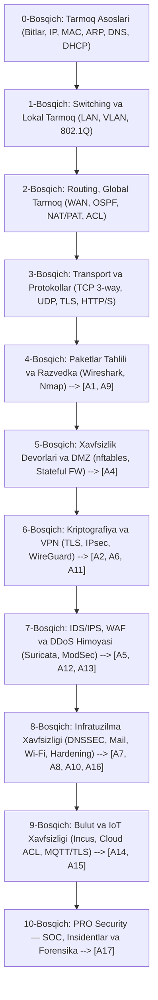

# 🌐 0-DAN PRO SECURITY DARAJASIGACHA TARMOQ VA TARMOQ XAVFSIZLIGI YO‘L XARITASI (ROADMAP)
### *Networking Fundamentals, "Under the Hood" jarayonlar, Cisco Packet Tracer laboratoriyalari va A1–A17 amaliy mashg‘ulotlar tizimi*

---

> **Ushbu qo‘llanma kim uchun?**  
> Ushbu qo‘llanma kompyuter tarmoqlari haqida umuman tushunchaga ega bo‘lmagan, lekin kelajakda tarmoq xavfsizligi, kiberxavfsizlik (SOC, Network Security, Blue Teaming, Penetration Testing) sohasida professional darajaga chiqmoqchi bo‘lgan va joriy papkadagi **A1–A17** amaliy mashg‘ulotlarini mustaqil, ongli ravishda tushunib bajarishni maqsad qilgan o‘rganuvchilar uchun tayyorlandi.

---

## 📑 MUNDARIJA

1. [Joriy papkadagi mashg‘ulotlar tahlili va muammo mohiyati](#1-joriy-papkadagi-mashgulotlar-tahlili)
2. [Orqa fonda nima yuz beradi? (Under the Hood / Deep Dive)](#2-orqa-fonda-nima-yuz-beradi-under-the-hood)
   * *Elektr signallari, bitlar va aloqa muhiti*
   * *OSI va TCP/IP modellari: Paket qanday kiyintiriladi (Encapsulation)?*
   * *MAC vs IP vs Port: Oddiy hayotiy analogiyalar*
   * *Brauzerga `https://google.com` yozib `Enter` bosilganda nima sodir bo‘ladi? (Millisekundlar tahlili)*
3. [0-dan PRO Xavfsizlikkacha 10 ta Bosqichli Yo‘l Xaritasi](#3-0-dan-pro-xavfsizlikkacha-10-ta-bosqichli-yol-xaritasi)
   * *0-Bosqich: Tarmoq asoslari (Bitlar, Kabellar, IP, MAC, ARP, DHCP, DNS)*
   * *1-Bosqich: Lokal Tarmoq (LAN), Switching va VLAN segmentatsiyasi*
   * *2-Bosqich: Marshrutlash (Routing), Global tarmoq (WAN) va NAT*
   * *3-Bosqich: Transport va Dastur qatlamlari (TCP, UDP, TLS, HTTP/S)*
   * *4-Bosqich: Paketlar tahlili va Razvedka (Wireshark, Nmap, A1, A9)*
   * *5-Bosqich: Xavfsizlik devorlari (Firewalls), DMZ va nftables (A4)*
   * *6-Bosqich: Kriptografiya, Xavfsiz kanallar va VPN (TLS, IPsec, WireGuard, A2, A6, A11)*
   * *7-Bosqich: Hujumlarni aniqlash va himoya (IDS/IPS, WAF, DDoS, A5, A12, A13)*
   * *8-Bosqich: Protokollar xavfsizligi, Simsiz tarmoq va Qurilmalarni mustahkamlash (A7, A8, A10, A16)*
   * *9-Bosqich: Bulut va IoT xavfsizligi (Incus, Cloud ACL, MQTT/TLS, A14, A15)*
   * *10-Bosqich: PRO Xavfsizlik — SOC, Insidentlar va Forensika (A17)*
4. [Cisco Packet Tracer Maxsus Amaliy Qo‘llanmasi (6 ta Asosiy Laboratoriya)](#4-cisco-packet-tracer-maxsus-amaliy-qollanmasi)
   * *Simulation Mode mo‘jizasi — orqa fondagi paketlarni ko‘rish*
   * *Lab 1: Boshlang‘ich LAN, Hub vs Switch, ARP va ICMP tekshiruvi*
   * *Lab 2: Korporativ VLAN, 802.1Q Trunk va Port Security*
   * *Lab 3: Router-on-a-stick va Inter-VLAN Routing*
   * *Lab 4: Korporativ tarmoqni Internetga ulash (OSPF + NAT/PAT)*
   * *Lab 5: Standart va Kengaytirilgan ACL (Traffic Filtering)*
   * *Lab 6: Filiallararo IPsec VPN Tuneli*
5. [A1–A17 Mashg‘ulotlar Matritsasi va O‘rganish Ketma-ketligi](#5-a1a17-mashgulotlar-matritsasi)
6. [Oltin Manbalar To‘plami (Kitoblar, Kurslar, Platformalar, Sertifikatlar)](#6-oltin-manbalar-toplami)
7. [Siz Yuklagan Kitob Bo‘yicha Maxsus O‘qish Rejasi (Kurose & Ross)](#7-siz-yuklagan-kitob-boyicha-maxsus-oqish-rejasi)
   * *Nega aynan bu kitob dunyoda №1?*
   * *Boblar, Cisco Packet Tracer va A1–A17 laboratoriyalari sinxronizatsiyasi jadvali*
   * *8 haftalik intensiv o‘rganish taqvimi*
8. [Xulosa va Yangi Boshlovchiga Muhandislik Maslahatlari](#8-xulosa-va-muhandislik-maslahatlari)

---

## 1. JORIY PAPKADAGI MASHG‘ULOTLAR TAHLILI

Ushbu papka universitetning **"Tarmoq xavfsizligi" (Network Security)** fanining 16 ta mukammal va real ishlab chiqarish (production) darajasidagi amaliy loyihalarini o‘z ichiga oladi:

| Papka | Asosiy Mavzusi | Ishlatilgan Texnologiyalar | Nima uchun hozir qiyin? |
| :--- | :--- | :--- | :--- |
| **A1_project** | Tarmoq aktivlari, tahdidlar va risklarni tahlil qilish | Nmap, Asset Inventory, Risk Matrix | Tarmoqda IP va port nima ekanini bilmasdan skanerlash tushunarsiz bo‘ladi. |
| **A2_project** | TLS, SSH va IPsec himoyalangan kanallari | OpenSSL, strongSwan (IPsec), OpenSSH | Shifrlash, sertifikatlar zanjiri va tunel tushunchasi bo‘lmasa, tushunish og‘ir. |
| **A4_project** | Stateful nftables, LAN SNAT va DMZ DNAT | Netfilter/nftables, IP forwarding | L3 marshrutlash va NAT qanday ishlashini bilmay, firewall qoidasi yozib bo‘lmaydi. |
| **A5_project** | IDS/IPS Tizimlari va NFQUEUE bloklash | Suricata, Scapy, NFQUEUE | Paketlar strukturasi va imzolarni (signature) tushunish talab etiladi. |
| **A6_project** | Least Privilege masofaviy kirish (WireGuard) | WireGuard VPN, Linux routing | VPN qanday qilib virtual interfeys orqali trafikni shifrlashini bilish kerak. |
| **A7_project** | DNS va E-pochta xavfsizligi | DNSSEC, STARTTLS, SPF, DKIM, DMARC | DNS va SMTP protokollarining orqa fon mexanizmlari poydevor hisoblanadi. |
| **A8_project** | Simsiz tarmoq xavfsizligi (WPA3-SAE, PMF) | hostapd, wpa_supplicant, 802.11w | Wi-Fi dagi 4-way handshake va L2 kadrlarni tushunish lozim. |
| **A9_project** | Wireshark va NetFlow monitoring | Wireshark, tshark, softflowd, nfdump | PDU (Frame, Packet, Segment) nimaligini bilmasdan tahlil qilib bo‘lmaydi. |
| **A10_project** | DLP va NAC siyosatlarini joriy etish | OpenNAC / PacketFence, DLP qoidalari | 802.1X autentifikatsiya va korporativ tarmoq arxitekturasi bazasi kerak. |
| **A11_project** | Masofaviy kirishni himoyalash (Hardening) | SSH Key, Fail2ban, PAM, RDP | Brute-force, port scanning va autentifikatsiya loglari bazasi kerak. |
| **A12_project** | DDoS hujumlaridan qatlamli himoya | nftables synproxy, rate limiting, hping3 | TCP SYN Flood qanday qilib server xotirasini to‘ldirishini bilish kerak. |
| **A13_project** | Proxy va WAF (Web Application Firewall) | Apache Reverse Proxy, ModSecurity, OWASP | HTTP so‘rov/javob sikli va L7 darajadagi filtrlashni tushunish shart. |
| **A14_project** | Xususiy bulutda segmentatsiya va ACL | Incus / LXD, OVN, Cloud ACL | Virtualizatsiya tarmoqlari va bulut arxitekturasini bilish lozim. |
| **A15_project** | IoT xavfsizligi va MQTT/TLS nazorati | Mosquitto MQTT, MQTTS, Karantin | IoT protokollari va mikrosegmentatsiya mantiqini talab qiladi. |
| **A16_project** | Router Hardening va Xavfsizlik Auditi | CIS Benchmark, Linux kernel sysctl, Lynis | Tarmoq qurilmasining yadro xavfsizligi va audit madaniyatini talab qiladi. |
| **A17_project** | Tarmoq insidentlarini boshqarish (IR) | Forensic logs, Containment, Remediation | Oldingi barcha bosqichlarning umumiy xulosasi va daliliy ekspertizasi. |

> **⚠️ Boshlang‘ich xulosa:**  
> Siz to‘g‘ridan-to‘g‘ri A4 yoki A5 papkasini ochib, buyruqlarni nusxalash orqali bajarsangiz, "Sehrgar"dek ko‘rinasiz, lekin konsolda nima bo‘layotganini tushunmaysiz. Agar ertaga tizimda xatolik yuz bersa, uni tuzata olmaysiz. Shuning uchun biz avval **"orqa fonda nima bo‘ladi?"** degan savolga javob olamiz, so‘ngra **Cisco Packet Tracer** orqali virtual tarmoq qurib, ko‘zimiz bilan ko‘ramiz, va shundan keyingina Linux muhitidagi ushbu amaliyotlarni "urib yoradigan" darajaga chiqamiz!

---

## 2. ORQA FONDA NIMA YUZ BERADI? (UNDER THE HOOD)

### 2.1. Elektr signallari, bitlar va aloqa muhiti
Dunyodagi barcha ma’lumotlar (matn, audio, video, o‘yinlar, parollar) kompyuter xotirasida faqat **0 va 1 (bitlar)** ko‘rinishida saqlanadi.
Kompyuteringiz boshqa kompyuterga ma’lumot uzatmoqchi bo‘lsa, bu 0 va 1 lar fizik muhitga qarab quyidagilarga aylanadi:
1. **Mis kabellar (UTP/Twisted Pair — Ethernet):** Kuchlanishning o‘zgarishi (masalan, +5V — 1, 0V — 0).
2. **Optik tolali kabellar (Fiber Optic):** Yorug‘lik chaqnashi (lazer nuri bor — 1, nur yo‘q — 0).
3. **Simsiz tarmoq (Wi-Fi, 4G/5G, Radio):** Elektromagnit to‘lqinlarning chastotasi yoki amplitudasi o‘zgarishi.

Lekin oddiy bitlar oqimi kimdan kimga ketayotganini, qayerda boshlanib qayerda tugashini bilmaydi. Shuning uchun insoniyat **tarmoq protokollari va modellarini** o‘ylab topdi.

---

### 2.2. OSI va TCP/IP Modellari: Qadoqlash (Encapsulation) qanday ishlaydi?

Tasavvur qiling, siz do‘stingizga qimmatbaho soat sovg‘a qilib yubormoqchisiz:
1. Soatni qutiga solasiz (Dastur qatlami).
2. Qutining ustiga xat yozib, ishonchli yetkazish shartnomasini ilovasiz (Transport qatlami).
3. Uni pochta konvertiga solib, shahar va ko‘cha manzilini (IP manzil) yozasiz (Tarmoq qatlami).
4. Pochtachi uni qaysi mashinaga yuklash kerakligini belgilovchi maxsus shtrix-kod (MAC manzil) yopishtiradi (Kanal qatlami).
5. Mashina uni asfalt yo‘l orqali olib ketadi (Fizik qatlam).

Tarmoqda ham xuddi shunday:

```
[Kompyuter A]                                                 [Kompyuter B]
+--------------------+                                       +--------------------+
| 7. Application     |  Ma'lumot (Data)                      | 7. Application     |
| 6. Presentation    |  Masalan: "Salom Dunyo!"              | 6. Presentation    |
| 5. Session         |                                       | 5. Session         |
+--------------------+                                       +--------------------+
          | (Pastga tushadi: Encapsulation)                            ^ (Yuqoriga chiqadi: Decapsulation)
          v                                                            |
+--------------------+                                       +--------------------+
| 4. Transport       |  [TCP/UDP Header] + [Data]            | 4. Transport       |  PDU: Segment
+--------------------+  Portlar: 443 -> 54321                +--------------------+
          v                                                            ^
+--------------------+                                       +--------------------+
| 3. Network         |  [IP Header] + [TCP] + [Data]         | 3. Network         |  PDU: Packet
+--------------------+  IPlar: 192.168.1.5 -> 142.250.180.3  +--------------------+
          v                                                            ^
+--------------------+                                       +--------------------+
| 2. Data Link       |  [Eth Header] + [IP] + [TCP] + [Data] | 2. Data Link       |  PDU: Frame (Kadr)
+--------------------+  MAC: AA:BB:.. -> CC:DD:..            +--------------------+
          v                                                            ^
+--------------------+                                       +--------------------+
| 1. Physical        |  010101100101010010100110101010101    | 1. Physical        |  PDU: Bits
+--------------------+---------------------------------------+--------------------+
                                 Kabel / Wi-Fi
```

* **Encapsulation (Qadoqlash):** Ma’lumot yuqoridan pastga tushganda har bir qatlam o‘z sarlavhasini (Header) qo‘shib boradi.
* **Decapsulation (Qadoqdan chiqarish):** Qabul qiluvchi kompyuter pastdan yuqoriga qarab har bir sarlavhani o‘qib, tekshirib, yechib oladi.

---

### 2.3. MAC Manzil vs IP Manzil vs Port: Oddiy Hayotiy O‘xshatish

Ko‘pchilik boshlang‘ich o‘rganuvchilar MAC, IP va Port farqini adashtiradilar. Keling, buni oddiy pochta misolida tushunamiz:

| Tushuncha | Qatlam | Hayotiy o‘xshatish | Haqiqiy vazifasi | Misol |
| :--- | :--- | :--- | :--- | :--- |
| **MAC Manzil** | L2 (Data Link) | Shaxsning **JSHSHIR (Pasport ID)** raqami | Bir xil lokal tarmoq (switch) ichida aynan qaysi tarmoq kartasiga (chipga) yetkazishni belgilaydi. Global internetda o‘zgarmaydi, har bir hopda (sakrashda) yangilanadi. | `00:1A:2B:3C:4D:5E` |
| **IP Manzil** | L3 (Network) | Shaxs yashaydigan **Uy manzili** (Toshkent, Chilonzor, 5-uy) | Dunyo bo‘yicha global paket qaysi tarmoqqa va qaysi xostga borishini belgilaydi. Joylashuv o‘zgarsa, IP o‘zgaradi. | `192.168.1.100` (Lokal)<br>`142.250.180.3` (Ommaviy) |
| **Port Raqami** | L4 (Transport) | Kvartiradagi **Xonalar yoki Shaxslar** (Ota, Ona, Bola) | Bitta kompyuter ichida yuzlab dasturlar ishlaydi. Paket aynan brauzergami, Telegramgami, o‘yingami yoki veb-servergami borishini aniqlaydi. | `80` (HTTP), `443` (HTTPS)<br>`22` (SSH), `53` (DNS) |

---

### 2.4. Brauzerga `https://google.com` yozib `Enter` bosilganda orqa fonda nima sodir bo‘ladi?

Bu savol — **Google, Cisco, Amazon va dunyoning barcha yetakchi xavfsizlik kompaniyalarining №1 intervyu savoli** hisoblanadi. Agar siz bu jarayonni ko‘z oldingizga keltira olsangiz, siz tarmoqning 70% sirini tushungansiz!

Keling, jarayonni soniyaning mingdan bir ulushlarida (millisekundlarda) tahlil qilamiz:

```
[Sizning PC]                  [Lokal Router]               [DNS Server]             [Google Server]
192.168.1.10                   192.168.1.1                   8.8.8.8                 142.250.180.3
     |                              |                             |                         |
     | 1. DNS so'rovi (UDP 53)      |                             |                         |
     |----------------------------->|---------------------------->|                         |
     |                              |   "google.com IPsi nima?"   |                         |
     |                              |<----------------------------|                         |
     |<-----------------------------|   "Uning IPsi: 142.250.180.3|                         |
     | 2. ARP So'rovi (Broadcast)   |                             |                         |
     | "192.168.1.1 MACi kimda?"    |                             |                         |
     |----------------------------->|                             |                         |
     |<-----------------------------| (Router MAC javob beradi)   |                         |
     |                              |                             |                         |
     | 3. TCP 3-Way Handshake       |                             |                         |
     | SYN (Port 443 ga) ---------->|============================>=========================>|
     |<-----------------------------|<============================<=========================| SYN-ACK
     | ACK ------------------------>|============================>=========================>|
     |                              |                             |                         |
     | 4. TLS 1.3 Handshake (Shifrlash kalitlari, Sertifikat tekshiruvi)                    |
     |<============================>=============================>=========================>|
     |                              |                             |                         |
     | 5. Shifrlangan HTTP GET / so'rovi                          |                         |
     |----------------------------->|============================>=========================>|
     |<-----------------------------|<============================<=========================| HTTP 200 OK (HTML)
```

#### Bosqichma-bosqich jarayon:
1. **Dastur qatlami va DNS (Domain Name System):**
   * Brauzer `google.com` degan so‘zni tushunadi, lekin tarmoq kartasi faqat raqamli IP manzil bilan ishlaydi.
   * Kompyuter avval o‘zining keshini va `/etc/hosts` faylini tekshiradi. Topolmasa, tarmoq sozlamalarida ko‘rsatilgan DNS serverga (masalan, `8.8.8.8` yoki provayder DNSiga) **UDP 53-port** orqali so‘rov yuboradi: *"Menga google.com ning IP manzilini ber"*.
   * DNS server javob qaytaradi: `142.250.180.3`.

2. **Lokal yo‘naltirish va ARP (Address Resolution Protocol):**
   * Kompyuteringiz `142.250.180.3` manzili o‘zining lokal tarmog‘ida (`192.168.1.0/24`) emasligini Subnet Mask orqali tushunadi.
   * Demak, paketni **Default Gateway**ga (uyingizdagi Wi-Fi routerga) yuborish kerak!
   * Routeringizning IPsi ma’lum (`192.168.1.1`), lekin uning L2 **MAC manzili** qanday?
   * Kompyuter lokal tarmoqqa baqiradi (ARP Broadcast — `FF:FF:FF:FF:FF:FF`): *"Kimda 192.168.1.1 bo‘lsa, o‘z MAC manzilini aytsin!"*.
   * Router o‘z MAC manzilini qaytaradi (ARP Reply). Kompyuter buni o‘zining **ARP keshida** saqlab qo‘yadi.

3. **Marshrutlash va NAT (Network Address Translation):**
   * Kompyuter paketni shakllantiradi: `Source IP: 192.168.1.10`, `Dest IP: 142.250.180.3`, `Dest MAC: Router_MAC`.
   * Router paketni qabul qiladi. Uning ichki IPsi (`192.168.1.10`) xususiy (Private / RFC 1918) bo‘lgani uchun global internetda yurish huquqiga ega emas!
   * Router **NAT/PAT** orqali manba manzilni o‘zining tashqi ommaviy (Public) IP manziliga o‘zgartiradi va provayder orqali jahon bo‘ylab routerdan-routerga (BGP va OSPF protokollari yordamida) yo‘naltiradi.

4. **Transport qatlami: TCP 3-Way Handshake:**
   * HTTPS xavfsiz va ishonchli protokol bo‘lgani uchun TCP ustida ishlaydi. Ma’lumot almashishdan oldin ikki tomon "qo‘l berib ko‘rishadi":
     * **SYN (Synchronize):** Kompyuter Google serveriga tasodifiy raqam (Sequence Number) bilan so‘rov yuboradi.
     * **SYN-ACK:** Google server so‘rovni qabul qilganini tasdiqlab, o‘zining Sequence raqami bilan javob qaytaradi.
     * **ACK (Acknowledge):** Kompyuter yakuniy tasdiqni yuboradi. Aloqa o‘rnatildi!

5. **Xavfsizlik qatlami: TLS 1.3 Handshake (Shifrlash):**
   * Ochiq HTTP orqali ma’lumot yuborilsa, yo‘ldagi har qanday xaker yoki provayder parollaringizni ko‘rib oladi.
   * Shuning uchun TLS ishga tushadi: Google o‘zining raqamli sertifikatini yuboradi. Kompyuteringiz sertifikat haqiqiyligini tekshiradi (CA orqali). So‘ngra Diffie-Hellman algoritmi orqali faqat shu sessiya uchun mo‘ljallangan simmetrik shifrlash kaliti (AES) yaratiladi.

6. **Ma’lumot uzatish va Render:**
   * Brauzer shifrlangan `GET / HTTP/1.1` so‘rovini yuboradi.
   * Google veb-serveri `200 OK` kodi bilan HTML, CSS va JavaScript fayllarini qaytaradi.
   * Brauzer ekraningizda chiroyli Google qidiruv sahifasini chizib beradi (Render).

*Bularning barchasi atigi **30–80 millisekund** ichida sodir bo‘ladi!*

---

## 3. 0-DAN PRO XAVFSIZLIKKACHA 10 TA BOSQICHLI YO‘L XARITASI

Ushbu yo‘l xaritasi sizni nazariyadan amaliyotga, oddiy tarmoq tushunchalaridan tortib to korporativ xavfsizlik arxitekturasi va papkadagi A1–A17 mashg‘ulotlarigacha qadamma-qadam olib boradi.



---

### 0-BOSQICH: Tarmoq Fundamental Asoslari (Zero Level)

* **O‘rganiladigan tushunchalar:**
  * Tarmoq topologiyalari (Yulduz, Shina, Halqa).
  * IPv4 manzillash: Klasslar (A, B, C), Xususiy (Private) va Ommaviy (Public) IP manzillar (RFC 1918: `10.0.0.0/8`, `172.16.0.0/12`, `192.168.0.0/16`).
  * Subnetting (Quyi tarmoqlarga ajratish): Nega `/24` 254 ta xost degani? Tarmoq ID va Broadcast ID nima?
  * Port tushunchasi: Well-known ports (0–1023), Registered ports (1024–49151), Dynamic/Ephemeral ports (49152–65535).
  * DHCP (Dynamic Host Configuration Protocol): Kompyuter yoqilganda IP manzilni qanday qilib avtomatik oladi (DORA: Discover -> Offer -> Request -> Acknowledge)?
* **Orqa fonda nima bo‘ladi?**
  * Tarmoq kartasi (NIC) drayveri operatsion tizim yadrosiga paket kelganini bildirish uchun apparat uzilishini (Hardware Interrupt - IRQ) chaqiradi.
* **Cisco Packet Tracer roli:**
  * **Lab 1:** 2 ta PC va 1 ta Switch. Ularga statik IP berib, bir-biriga ping yuborish. Simulation Mode'da ARP va ICMP harakatini ko‘rish.

---

### 1-BOSQICH: Lokal Tarmoq (LAN), Switching va VLAN

* **O‘rganiladigan tushunchalar:**
  * **Hub vs Switch:** Hub ko‘r bo‘lib, kelgan paketni hammaga tarqatadi (Broadcast/Collision bo‘ladi). Switch aqlli bo‘lib, MAC-manzillar jadvalini (CAM Table) tuzadi va paketni faqat kerakli portga yuboradi (Unicast).
  * **Broadcast Domain va Collision Domain:** Nega tarmoqda 500 ta kompyuter bitta switcheda bo‘lsa, tarmoq "cho‘kadi"?
  * **VLAN (Virtual LAN):** Bitta fizik switchni mantiqiy mustaqil tarmoqlarga ajratish (masalan, Buxgalteriya VLAN 10, Talabalar VLAN 20). Ular o‘zaro routersiz gaplasha olmaydi!
  * **Access Port vs Trunk Port:** Access bitta VLANga xizmat qiladi, Trunk port esa bir nechta VLAN trafiklarini **802.1Q tegi** bilan o‘tkazadi.
  * **L2 Xavfsizlik zaifliklari va hujumlar:**
    * MAC Flooding: Switch CAM jadvalini soxta MAC lar bilan to‘ldirib, uni Hub holatiga keltirish.
    * ARP Spoofing/Poisoning: O‘zini router deb ko‘rsatib, trafikni o‘g‘irlash (Man-in-the-Middle).
* **Cisco Packet Tracer roli:**
  * **Lab 2:** Cisco Catalyst 2960 switchida VLAN 10 va VLAN 20 yaratish, Trunk sozlash, Port Security (begona noutbuk ulanganda portni bloklash) sozlash.

---

### 2-BOSQICH: Marshrutlash (Routing), Global Tarmoq va NAT

* **O‘rganiladigan tushunchalar:**
  * Router qanday qaror qabul qiladi? **Routing Table (Marshrutlash jadvali)**: Eng uzun prefiks mosligi (Longest Prefix Match).
  * **Inter-VLAN Routing:** Har xil VLANlarni o‘zaro bog‘lash: Router-on-a-stick (bitta kabelda sub-interfeyslar: `Gig0/0.10`, `Gig0/0.20`) yoki L3 Switch (SVI).
  * **Statik vs Dinamik Marshrutlash:** Statik yo‘nalish (`ip route 0.0.0.0 0.0.0.0 ...`) va Dinamik protokollar (OSPF — Open Shortest Path First, BGP — Internetning tayanchi).
  * **NAT (Network Address Translation):**
    * Static NAT: 1 ta ichki IP -> 1 ta tashqi IP.
    * PAT (Port Address Translation / NAT Overload): Minglab ichki kompyuterlar yagona ommaviy IP orqali har xil portlar bilan internetga chiqishi.
  * **ACL (Access Control Lists):**
    * Standart ACL (1–99): Faqat Manba IP bo‘yicha tekshiradi.
    * Kengaytirilgan ACL (100–199): Manba IP, Maqsad IP, Protokol (TCP/UDP/ICMP) va Port bo‘yicha qat’iy filtrlaydi.
* **Cisco Packet Tracer roli:**
  * **Lab 3 & 4:** Router-on-a-stick sozlash, OSPF marshrutlash, Korxona uchun PAT sozlash va Extended ACL orqali faqat xavfsiz portlarni ochish.

---

### 3-BOSQICH: Transport va Dastur Qatlamlari (TCP, UDP, TLS, HTTP/S)

* **O‘rganiladigan tushunchalar:**
  * **TCP (Transmission Control Protocol):** Ishonchli, ulanish o‘rnatuvchi protokol. Flags: SYN, ACK, FIN, RST, PSH, URG. Oqim nazorati (Windowing, Congestion control).
  * **UDP (User Datagram Protocol):** Tezkor, tekshiruvsiz protokol (DNS, VoIP, Video oqim, Online o‘yinlar).
  * **HTTP/1.1 vs HTTP/2 vs HTTP/3 (QUIC/UDP):** So‘rov/javob sikli, Status kodlar (200, 301, 403, 404, 500, 502).
  * **TLS/SSL Handshake:** Asimmetrik shifrlash orqali simmetrik sessiya kalitini xavfsiz almashish.
* **Orqa fonda nima bo‘ladi?**
  * Agar TCP paket yo‘lda yo‘qolsa, qabul qiluvchi tomon ACK qaytarmaydi va jo‘natuvchi belgilangan vaqt (Retransmission Timeout) o‘tgach paketni qayta jo‘natadi.

---

### 4-BOSQICH: Paketlar Tahlili va Razvedka (Sniffing & Reconnaissance)

* **O‘rganiladigan tushunchalar:**
  * Tarmoq kartasining **Promiscuous Mode** rejimi (begona paketlarni ham eshitish).
  * **Wireshark va Tshark:** Filtrlash sintaksisi (`tcp.port == 443`, `http.request.method == "POST"`, `ip.src == 192.168.1.0/24`), TCP oqimini yig‘ish (Follow TCP Stream).
  * **NetFlow / IPFIX:** Paketlarning ichini to‘liq o‘qimasdan, faqat meta-ma’lumotlarini (Kim? Kim bilan? Qachon? Qancha hajmda?) yig‘ish texnologiyasi.
  * **Nmap (Network Mapper):** Host Discovery (Ping sweep), Port skanerlash turlari (TCP SYN Scan `-sS`, TCP Connect `-sT`, UDP Scan `-sU`), Xizmat versiyasini va OS ni aniqlash (`-sV`, `-O`), NSE skriptlari (`--script vuln`).
* **📁 Papkadagi Mashg‘ulotlar Integratsiyasi:**
  * **`A1_project`:** Aktivlar inventari, Nmap skanerlash, zaifliklarni aniqlash va Risk matritsasini tuzish.
  * **`A9_project`:** Wireshark va NetFlow vositalari yordamida paketlar va oqimlarni taqqoslagan holda tarmoq anomaliyalarini monitoring qilish.

---

### 5-BOSQICH: Xavfsizlik Devorlari (Firewalls), DMZ va Linux Netfilter/nftables

* **O‘rganiladigan tushunchalar:**
  * Xavfsizlik devori turlari: Stateless (Holatsiz) vs Stateful (Ulanish holatini eslab qoluvchi).
  * **DMZ (Demilitarized Zone):** Ichki tarmoq (LAN) va Tashqi internet o‘rtasidagi bufer hudud. Agar DMZ dagi veb-server buzib kirilsa ham, xaker ichki LAN tarmog‘iga o‘ta olmaydi!
  * **Linux Netfilter va `nftables`:**
    * Jadval va zanjirlar (`prerouting`, `input`, `forward`, `output`, `postrouting`).
    * Holatli nazorat (`conntrack` moduli): `ct state { established, related } accept`.
    * SNAT (Masquerade) va DNAT (Port Forwarding: masalan tashqi 8080 portni DMZ dagi 80 portga yo‘naltirish).
    * "Default Drop" xavfsizlik falsafasi: Ruxsat berilmagan barcha narsa qat’iy taqiqlanadi!
* **📁 Papkadagi Mashg‘ulotlar Integratsiyasi:**
  * **`A4_project`:** Ubuntu Serverda nftables yordamida 3 ta zona (LAN, WAN, DMZ) arxitekturasini qurish, Stateful qoidalar, SNAT va DNAT ni amalda qo‘llash.

---

### 6-BOSQICH: Kriptografiya, Xavfsiz Kanallar va VPN Texnologiyalari

* **O‘rganiladigan tushunchalar:**
  * Kriptografik primitivlar: Xesh funksiyalar (SHA-256), Simmetrik shifrlash (AES-GCM, ChaCha20), Asimmetrik shifrlash (RSA, Curve25519).
  * PKI (Public Key Infrastructure): CA (Sertifikatlash markazi), X.509 sertifikatlar, Zanjirli ishonch (Chain of Trust).
  * **SSH Hardening:** Parolli kirishni o‘chirish, Ed25519 kalitli autentifikatsiya, Root kirishni taqiqlash, Fail2ban orqali brute-force hujumlarni bloklash.
  * **VPN (Virtual Private Network):**
    * **IPsec:** Korporativ filiallararo himoyalangan tunel (IKEv2, ESP shifrlash, AH yaxlitlik).
    * **WireGuard:** Zamonaviy, yengil, tezkor va xavfsiz VPN protokoli (Noise protokoliga asoslangan).
* **📁 Papkadagi Mashg‘ulotlar Integratsiyasi:**
  * **`A2_project`:** Ikki server o‘rtasida TLS, SSH va IPsec tunellarini sozlash.
  * **`A6_project`:** WireGuard orqali eng kam ruxsatli (Least Privilege) masofaviy kirish arxitekturasini yaratish.
  * **`A11_project`:** SSH va RDP xizmatlarini xavfsiz sozlash (Hardening, Rate limiting, Masofaviy nazorat).

---

### 7-BOSQICH: Hujumlarni Aniqlash va Qatlamli Himoya (IDS/IPS, WAF, DDoS)

* **O‘rganiladigan tushunchalar:**
  * **IDS (Intrusion Detection System) vs IPS (Intrusion Prevention System):** IDS faqat ogohlantiradi (Sniffer rejimida), IPS esa paketni yo‘lda to‘xtatadi va bloklaydi (Inline rejimida).
  * **Suricata IDS/IPS:** Qoidalar (Rules) yozish sintaksisi, Fast-log va EVE.JSON loglari tahlili, Linux `NFQUEUE` orqali paketlarni real vaqtda ushlab filtrlash.
  * **Reverse Proxy va WAF (Web Application Firewall):**
    * Nega veb-server to‘g‘ridan-to‘g‘ri internetga chiqmasligi kerak? Apache / Nginx teskari proksi vazifasi.
    * ModSecurity WAF va OWASP Core Rule Set (CRS): SQL Injection, Cross-Site Scripting (XSS), Local File Inclusion (LFI) hujumlarini HTTP darajasida aniqlab yo‘q qilish.
  * **DDoS (Distributed Denial of Service) Hujumlari va Himoya:**
    * L4 hujumlar (SYN Flood, UDP Reflection) va L7 hujumlar (HTTP Flood, Slowloris).
    * Himoya mexanizmlari: `synproxy` (TCP SYN Cookies), Rate limiting (murojaatlar sonini cheklash).
* **📁 Papkadagi Mashg‘ulotlar Integratsiyasi:**
  * **`A5_project`:** Suricata IDS o‘rnatish, qoidalar yozish va NFQUEUE orqali tahdidlarni avtomatik bloklovchi IPS sozlash.
  * **`A12_project`:** nftables yordamida DDoS hujumlariga qarshi ko‘p qatlamli himoya (synproxy, rate limit, xakerlarni vaqtincha ban qilish).
  * **`A13_project`:** Apache Reverse Proxy, ModSecurity 2.x va OWASP CRS qoidalar to‘plamini o‘rnatib, veb-ilovani himoyalash.

---

### 8-BOSQICH: Infratuzilma Xavfsizligi, Simsiz Tarmoq va Qurilmalarni Mustahkamlash

* **O‘rganiladigan tushunchalar:**
  * **DNS Xavfsizligi va DNSSEC:** DNS keshini zaharlash (Cache Poisoning) ga qarshi kriptografik imzo (RRSIG, DNSKEY).
  * **Elektron Pochta Xavfsizligi:** Soxta nomdan xat yuborish (Email Spoofing) ga qarshi uchlik: **SPF** (qaysi IP yuborishi mumkin?), **DKIM** (xat yo‘lda o‘zgarmaganini tasdiqlovchi imzo), **DMARC** (tekshiruvdan o‘tmagan xat nima qilinsin?). STARTTLS orqali pochta shifrlash.
  * **Simsiz Tarmoq (Wi-Fi) Evolyutsiyasi:** WEP va WPA2 kamchiliklari, WPA3-SAE (Simultaneous Authentication of Equals — offline lug‘at hujumlariga chidamli), **802.11w PMF** (Protected Management Frames — Deauthentication hujumlarini to‘xtatish).
  * **NAC (Network Access Control) va DLP (Data Loss Prevention):** 802.1X korporativ kirish nazorati, nozik korporativ ma’lumotlarning tarmoqdan tashqariga chiqib ketishini aniqlash.
  * **Tarmoq Qurilmalarini Hardening Qilish:** CIS Benchmark talablari, keraksiz xizmatlarni (Telnet, HTTP, keraksiz portlar) o‘chirish, konfiguratsiyani zaxiralash va audit.
* **📁 Papkadagi Mashg‘ulotlar Integratsiyasi:**
  * **`A7_project`:** DNSSEC, STARTTLS hamda SPF–DKIM–DMARC yozuvlarini sozlash va tekshirish.
  * **`A8_project`:** Virtual Wi-Fi muhitida WPA3-SAE va majburiy PMF sozlash.
  * **`A10_project`:** Korxona tarmog‘ida DLP va NAC siyosatlarini modellashtirish.
  * **`A16_project`:** Virtual routerni hardening qilish, audit o‘tkazish, konfiguratsiyalarni zaxiralash va tiklash.

---

### 9-BOSQICH: Bulut va IoT Xavfsizligi (Cloud & IoT Security)

* **O‘rganiladigan tushunchalar:**
  * Bulut tarmoq arxitekturasi: VPC (Virtual Private Cloud), Virtual Switch, Overlay tarmoqlar (Geneve, VXLAN).
  * Bulutda xavfsizlik: Security Groups (Stateful) vs Network ACLs (Stateless). Mikrosegmentatsiya va Zero Trust tamoyillari.
  * **Incus / LXD / Proxmox:** Konteynerlar va virtual mashinalar uchun xavfsiz virtual tarmoqlar va ACL yaratish.
  * **IoT (Internet of Things) Tarmoq Xavfsizligi:** Aqlli qurilmalar, datchiklar xavfsizligi.
  * **MQTT Protokoli:** Publish/Subscribe modeli, MQTTS (MQTT over TLS), datchiklar uchun RBAC va Topic darajasida ruxsatlar, shubhali qurilmalarni alohida izolyatsiyalangan **Karantin** segmentiga haydash.
* **📁 Papkadagi Mashg‘ulotlar Integratsiyasi:**
  * **`A14_project`:** Incus xususiy bulutida uch qatlamli segmentatsiya va Network ACL qoidalarini joriy etish.
  * **`A15_project`:** IoT sensorlar, MQTT/TLS xavfsizligi, tarmoqlararo nazorat va datchiklarni karantinga olish.

---

### 10-BOSQICH: PRO Security — SOC, Insidentlar va Forensika (Blue Team Master)

* **O‘rganiladigan tushunchalar:**
  * **SOC (Security Operations Center):** 24/7 tarmoq monitoringi, L1/L2/L3 analitiklar faoliyati.
  * **SIEM Tizimlari:** Wazuh, Splunk, Elastic SIEM. Barcha tarmoq loglarini yagona joyga yig‘ish va korrelyatsiya qilish.
  * **Insidentlarga Javob Berish (Incident Response — NIST SP 800-61):**
    1. *Preparation (Tayyorgarlik)*
    2. *Detection & Analysis (Aniqlash va tahlil)*
    3. *Containment (Karantin / Tarmoqdan uzish)*
    4. *Eradication (Zaiflikni va zararkunandani yo‘q qilish)*
    5. *Recovery (Tizimni xavfsiz qayta ishga tushirish)*
    6. *Lessons Learned (Xulosa va xavfsizlik siyosatini kuchaytirish)*
  * **Tarmoq Forensikasi (Network Forensics):** PCAP fayllarni tahlil qilish, tajovuzkor qoldirgan izlarni (IoC — Indicators of Compromise) dalil sifatida hujjatlashtirish (Chain of Custody).
* **📁 Papkadagi Mashg‘ulotlar Integratsiyasi:**
  * **`A17_project`:** Ruxsatsiz kirish hodisasini log orqali aniqlash, ta’sir doirasini baholash, manbani izolyatsiya qilish, dalillarni saqlash, konfiguratsiyani tuzatish va to‘liq rasmiy hisobot tuzish.

---

## 4. CISCO PACKET TRACER MAXSUS AMALIY QO‘LLANMASI

**Cisco Packet Tracer** — bu shunchaki rasm chizadigan dastur emas! Bu yangi boshlovchi uchun tarmoq ichidagi jarayonlarni ko‘zi bilan ko‘rish imkonini beruvchi eng qudratli simulyatordir.

### 🔥 Simulation Mode mo‘jizasi
Packet Tracer ning pastki o‘ng burchagida ikkita rejim bor:
1. **Real-time Mode (Haqiqiy vaqt):** Tarmoq oddiy holatda ishlaydi.
2. **Simulation Mode (Simulyatsiya rejimi):** Vaqt to‘xtatiladi! Siz bitta tugmani bosganingizda, bitta paket kompyuterdan chiqib kabel bo‘ylab qanday ketayotganini ko‘rasiz. Paket ustiga bossangiz, uning **L1, L2, L3, L4 OSI qatlamlari sarlavhalari** (MAC, IP, Port) ochiladi. Bu sizga yuqorida tushuntirilgan "Encapsulation" jarayonini o‘z ko‘zingiz bilan ko‘rish imkonini beradi!

---

### 🧪 LABORATORIYA 1: Boshlang‘ich LAN, ARP va ICMP tekshiruvi

```
[PC0: 192.168.1.10/24] ------- (Port Fa0/1) [Switch 2960] (Port Fa0/2) ------- [PC1: 192.168.1.20/24]
```

* **Qurilmalar:** 2 ta PC-PT, 1 ta Cisco Catalyst 2960 Switch, 2 ta Copper Straight-Through kabeli.
* **Qadamlar:**
  1. PC0 ga kiring: Desktop -> IP Configuration -> IP: `192.168.1.10`, Mask: `255.255.255.0`.
  2. PC1 ga kiring: Desktop -> IP Configuration -> IP: `192.168.1.20`, Mask: `255.255.255.0`.
  3. **Simulation Mode** ga o‘ting (`Shift + S`).
  4. Filtrlarda faqat **ICMP** va **ARP** ni qoldiring.
  5. PC0 dan Command Prompt oching va yozing: `ping 192.168.1.20`.
  6. **Capture/Forward** tugmasini bosing:
     * *Mo‘jizani ko‘ring:* PC0 birdaniga 2 ta konvert yaratadi: bittasi yashil (ICMP), bittasi ko‘k (ARP).
     * Nega ICMP darhol ketmaydi? Chunki PC0 PC1 ning MAC manzilini bilmaydi!
     * Avval ARP so‘rovi switch orqali PC1 ga boradi, PC1 o‘z MAC manzilini qaytaradi.
     * Shundan keyingina ICMP ping paketi yo‘lga chiqadi!
  7. Switch CLI ga kiring va MAC jadvalini tekshiring:
     ```ios
     Switch> enable
     Switch# show mac address-table
     ```

---

### 🧪 LABORATORIYA 2: Korporativ VLAN, 802.1Q Trunk va Port Security

```
[VLAN 10: HR]      (Fa0/1)                              (Fa0/1) [VLAN 10: HR]
[PC-HR1: .10] ----+                                    +---- [PC-HR2: .11]
                  | [Switch-A] === (Trunk Gi0/1) === [Switch-B] |
[VLAN 20: IT] ----+ (Fa0/2)                              (Fa0/2) +---- [PC-IT2: .21]
[PC-IT1: .20]                                                 [PC-IT2: .21]
```

* **Maqsad:** HR kompyuterlari faqat o‘zaro, IT esa faqat IT bilan gaplashsin. Bitta switch portiga begona noutbuk ulasa, port darhol o‘chib qolsin (Port Security).
* **Switch-A Konfiguratsiyasi (Cisco IOS buyruqlari):**
  ```ios
  Switch> enable
  Switch# configure terminal
  Switch(config)# hostname SW-A

  ! 1. VLANlarni yaratish
  SW-A(config)# vlan 10
  SW-A(config-vlan)# name HR_Department
  SW-A(config-vlan)# exit
  SW-A(config)# vlan 20
  SW-A(config-vlan)# name IT_Department
  SW-A(config-vlan)# exit

  ! 2. Portlarni VLANlarga biriktirish
  SW-A(config)# interface FastEthernet 0/1
  SW-A(config-if)# switchport mode access
  SW-A(config-if)# switchport access vlan 10
  SW-A(config-if)# exit

  SW-A(config)# interface FastEthernet 0/2
  SW-A(config-if)# switchport mode access
  SW-A(config-if)# switchport access vlan 20
  SW-A(config-if)# exit

  ! 3. Switchlar orasidagi Trunk portni sozlash
  SW-A(config)# interface GigabitEthernet 0/1
  SW-A(config-if)# switchport mode trunk
  SW-A(config-if)# exit

  ! 4. L2 Xavfsizlik: Port Security sozlash (Fa0/1 da)
  SW-A(config)# interface FastEthernet 0/1
  SW-A(config-if)# switchport port-security
  SW-A(config-if)# switchport port-security maximum 1
  SW-A(config-if)# switchport port-security mac-address sticky
  SW-A(config-if)# switchport port-security violation shutdown
  SW-A(config-if)# exit
  ```
* **Tekshirish:**
  * HR1 dan HR2 ga ping boradi.
  * HR1 dan IT1 ga ping bormaydi (chunki ular alohida VLAN da, L3 routersiz izolyatsiyalangan!).
  * Fa0/1 kabelini uzib, begona noutbukka ulasangiz, switch porti darhol qizarib, `err-disable` holatiga tushadi va xaker tarmoqdan uziladi!

---

### 🧪 LABORATORIYA 3: Router-on-a-stick va Inter-VLAN Routing

* **Maqsad:** HR va IT bo‘limlarini xavfsiz marshrutlash orqali nazorat ostida bog‘lash.
* **Topologiya:** Switch Gi0/2 portidan Router 2911 ning Gi0/0 portiga bitta kabel boradi.
* **Router 2911 Konfiguratsiyasi:**
  ```ios
  Router> enable
  Router# configure terminal
  Router(config)# hostname RTR-CORE

  ! Fizik interfeysni yoqamiz, lekin unga IP bermaymiz
  RTR-CORE(config)# interface GigabitEthernet 0/0
  RTR-CORE(config-if)# no shutdown
  RTR-CORE(config-if)# exit

  ! VLAN 10 uchun Sub-interfeys
  RTR-CORE(config)# interface GigabitEthernet 0/0.10
  RTR-CORE(config-subif)# encapsulation dot1Q 10
  RTR-CORE(config-subif)# ip address 192.168.10.1 255.255.255.0
  RTR-CORE(config-subif)# exit

  ! VLAN 20 uchun Sub-interfeys
  RTR-CORE(config)# interface GigabitEthernet 0/0.20
  RTR-CORE(config-subif)# encapsulation dot1Q 20
  RTR-CORE(config-subif)# ip address 192.168.20.1 255.255.255.0
  RTR-CORE(config-subif)# exit
  ```
* **Tekshirish:** PC lardagi Gateway manziliga ushbu sub-interfeys IP lari beriladi. Endi HR1 IT1 ga ping bera oladi, chunki paket routerga chiqib, 802.1Q tegi almashtirilib qaytadi!

---

### 🧪 LABORATORIYA 4: Korporativ tarmoqni Internetga ulash (OSPF + NAT/PAT)

* **Topologiya:** Ichki LAN (`192.168.10.0/24`) -> `RTR-EDGE` -> Provayder Routerni ko‘rsatuvchi WAN link (`203.0.113.0/30`) -> Internet Server (`8.8.8.8`).
* **Router NAT/PAT Konfiguratsiyasi:**
  ```ios
  RTR-EDGE(config)# interface GigabitEthernet 0/0
  RTR-EDGE(config-if)# ip nat inside
  RTR-EDGE(config-if)# exit

  RTR-EDGE(config)# interface Serial 0/0/0
  RTR-EDGE(config-if)# ip nat outside
  RTR-EDGE(config-if)# exit

  ! Qaysi ichki IP lar internetga chiqishi mumkinligini belgilovchi ACL
  RTR-EDGE(config)# access-list 1 permit 192.168.10.0 0.0.0.255

  ! PAT (Overload) qoidasi: Serial portining yagona ommaviy IP siga almashtirish
  RTR-EDGE(config)# ip nat inside source list 1 interface Serial 0/0/0 overload

  ! Standart yo'nalish (Default Route internetga)
  RTR-EDGE(config)# ip route 0.0.0.0 0.0.0.0 Serial 0/0/0
  ```
* **Tekshirish:**
  * Ichki PC dan `8.8.8.8` ga ping yuboring.
  * Router konsolida tekshiring:
    ```ios
    RTR-EDGE# show ip nat translations
    ```
  * Ko‘rasiz: `Inside Local: 192.168.10.5:1025` -> `Inside Global: 203.0.113.2:1025` ga o‘zgargan!

---

### 🧪 LABORATORIYA 5: Standart va Kengaytirilgan ACL (Traffic Filtering)

* **Maqsad:** Korporativ veb-serverga faqat HTTP/HTTPS ruxsat etilsin, lekin hech kim unga Ping (ICMP) yubora olmasin yoki SSH (Port 22) qila olmasin.
* **Extended ACL Konfiguratsiyasi (Cisco IOS):**
  ```ios
  RTR-EDGE(config)# ip access-list extended DMZ_SECURITY_POLICY
  
  ! Veb trafikka (Port 80 va 443) ruxsat
  RTR-EDGE(config-ext-nacl)# permit tcp any host 192.168.30.50 eq 80
  RTR-EDGE(config-ext-nacl)# permit tcp any host 192.168.30.50 eq 443

  ! Ping (ICMP) ni qat'iy taqiqlash va log yozish
  RTR-EDGE(config-ext-nacl)# deny icmp any host 192.168.30.50

  ! Qolgan barcha narsani yopish (Implicit Deny)
  RTR-EDGE(config-ext-nacl)# deny ip any any
  RTR-EDGE(config-ext-nacl)# exit

  ! Siyosatni interfeysga bog'lash
  RTR-EDGE(config)# interface GigabitEthernet 0/1
  RTR-EDGE(config-if)# ip access-group DMZ_SECURITY_POLICY out
  ```
* **Tekshirish:** Brauzerda veb-sahifa ochiladi, lekin `ping 192.168.30.50` yuborsangiz, `Destination Host Unreachable` xatosi chiqadi! Bu xuddi Linux dagi `nftables` (A4 loyihasi) kabi ishlaydi.

---

### 🧪 LABORATORIYA 6: Filiallararo IPsec VPN Tuneli (Site-to-Site)

* **Maqsad:** Toshkent filiali (`192.168.1.0/24`) va Samarqand filiali (`192.168.2.0/24`) o‘rtasida ochiq internet orqali o‘tuvchi paketlarni to‘liq shifrlash.
* **RTR-Toshkent Konfiguratsiyasi:**
  ```ios
  ! 1. Phase 1: ISAKMP (IKE) Siyosati
  RTR-TAS(config)# crypto isakmp policy 10
  RTR-TAS(config-isakmp)# encr aes 256
  RTR-TAS(config-isakmp)# hash sha256
  RTR-TAS(config-isakmp)# authentication pre-share
  RTR-TAS(config-isakmp)# group 14
  RTR-TAS(config-isakmp)# lifetime 86400
  RTR-TAS(config-isakmp)# exit

  ! Umumiy maxfiy kalit (Pre-shared Key)
  RTR-TAS(config)# crypto isakmp key MaxfiyKalit123 address 203.0.113.6

  ! 2. Phase 2: IPsec Transform Set
  RTR-TAS(config)# crypto ipsec transform-set MY_TRANSFORM esp-aes 256 esp-sha256-hmac
  RTR-TAS(cfg-crypto-trans)# exit

  ! Shifrlanadigan trafikni aniqlovchi ACL
  RTR-TAS(config)# access-list 110 permit ip 192.168.1.0 0.0.0.255 192.168.2.0 0.0.0.255

  ! 3. Crypto Map yaratish va interfeysga ulash
  RTR-TAS(config)# crypto map VPN_MAP 10 ipsec-isakmp
  RTR-TAS(config-crypto-map)# set peer 203.0.113.6
  RTR-TAS(config-crypto-map)# set transform-set MY_TRANSFORM
  RTR-TAS(config-crypto-map)# match address 110
  RTR-TAS(config-crypto-map)# exit

  RTR-TAS(config)# interface Serial 0/0/0
  RTR-TAS(config-if)# crypto map VPN_MAP
  ```
* **Tekshirish:** Simulation Mode da Toshkentdan Samarqandga ping yuborganingizda, oddiy ICMP paketi routerdan chiqqach **ESP (IP Protocol 50)** ga o‘ralib, shifrlanib ketishini ko‘rasiz! Bu xuddi bizning **A2 loyihamizdagi strongSwan IPsec** amaliyotining Cisco dagi nusxasidir.

---

## 5. A1–A17 MASHG‘ULOTLAR MATRITSASI VA O‘RGANISH KETMA-KETLIGI

Papkadagi amaliy ishlarni raqamlari bo‘yicha emas, balki mantiqiy murakkablik darajasi bo‘yicha quyidagi ketma-ketlikda bajarish **eng to‘g‘ri pedagogik va professional strategiya** hisoblanadi:

```
[BOSHLANG'ICH TAYYORGARLIK: 0-dan 3-bosqichgacha bo'lgan nazariya + Packet Tracer 1-4]
                                 |
                                 v
   QADAM 1: Razvedka va Monitoring -----------> [A1_project] (Aktivlar, Nmap, Risklar)
                                            +-> [A9_project] (Wireshark, NetFlow)
                                 |
                                 v
   QADAM 2: Tarmoq Chegarasi va NAT ----------> [A4_project] (Stateful nftables, DMZ, DNAT)
                                 |
                                 v
   QADAM 3: Xavfsiz Aloqa Kanallari ----------> [A11_project] (SSH/RDP Hardening, Fail2ban)
                                            +-> [A2_project] (TLS, SSH, IPsec)
                                            +-> [A6_project] (WireGuard Least Privilege)
                                 |
                                 v
   QADAM 4: Hujumlarni Qatlamli Qaytarish ----> [A5_project] (Suricata IDS/IPS, NFQUEUE)
                                            +-> [A12_project] (DDoS Himoyasi, synproxy)
                                            +-> [A13_project] (Apache Reverse Proxy, WAF)
                                 |
                                 v
   QADAM 5: Infratuzilma va Simsiz Tarmoq ----> [A8_project] (Wi-Fi WPA3-SAE, PMF)
                                            +-> [A7_project] (DNSSEC, SPF-DKIM-DMARC)
                                            +-> [A10_project] (DLP va NAC Siyosatlari)
                                            +-> [A16_project] (Router Hardening & Audit)
                                 |
                                 v
   QADAM 6: Maxsus Muhitlar (Bulut & IoT) ----> [A14_project] (Incus Cloud ACLs)
                                            +-> [A15_project] (IoT MQTT/TLS Karantin)
                                 |
                                 v
   QADAM 7: Cho'qqi (PRO Blue Team) ----------> [A17_project] (Tarmoq Insidentlarini Boshqarish)
```

### Har bir bosqichning o‘zlashtirish mezoni:
1. **A1 & A9 dan keyin:** Siz begona tarmoqqa kirib, unda qanday kompyuterlar borligini skanerlay olasiz va Wireshark da parollarni ushlay olasiz.
2. **A4 dan keyin:** Siz Linux mashinasini korporativ darajadagi router va firewall ga aylantirib, ichki xodimlarni himoyalay olasiz.
3. **A2, A6, A11 dan keyin:** Siz uzoqdagi serverlarni xavfsiz boshqarib, xakerlarga yopiq shifrlangan tunellar qura olasiz.
4. **A5, A12, A13 dan keyin:** Siz real DDoS yoki veb hujumlarni (SQLi, XSS) avtomatlashtirilgan tarzda qaytara olasiz.
5. **A7, A8, A10, A16 dan keyin:** Siz kompaniya infratuzilmasini CIS standartlari bo‘yicha to‘liq mustahkamlay olasiz.
6. **A14, A15 dan keyin:** Siz zamonaviy bulut va IoT datchiklarini mikrosegmentatsiyaga solib, karantin qila olasiz.
7. **A17 dan keyin:** Siz buzib kirilgan tarmoqda tergov o‘tkazib, xakerni fosh qiluvchi rasmiy kiber-ekspertiza hisobotini yoza olasiz!

---

## 6. OLTIN MANBALAR TO‘PLAMI (RESOURCES)

### 📚 Eng Sara Kitoblar (Kutubxonangizda bo‘lishi shart):
1. **Boshlang‘ich Networking uchun:**
   * *"Computer Networking: A Top-Down Approach"* — James Kurose & Keith Ross (Dunyodagi №1 darslik. Tarmoqni dastur qatlamidan pastga qarab tushuntiradi).
   * *"CCNA 200-301 Official Cert Guide (Volume 1 & 2)"* — Wendell Odom (Cisco ning rasmiy kitobi, apparat va protokollarni noldan professional darajada o‘rgatadi).
   * *"TCP/IP Illustrated, Volume 1"* — W. Richard Stevens (Tarmoqning "Injili". Har bir bayt va bayroq qanday ishlashini bilmoqchi bo‘lsangiz).
2. **Tarmoq Xavfsizligi va Tahlil uchun:**
   * *"Practical Packet Analysis"* — Chris Sanders (Wireshark orqali tarmoqni rentgen qilish san’ati).
   * *"Network Warrior"* — Gary A. Donahue (Haqiqiy korporativ tarmoqda ishlaydigan muhandislar uchun amaliy maslahatlar).
   * *"Linux Firewalls: Enhancing Security with nftables and Beyond"* — Steve Suehring (A4 laboratoriyasi uchun eng zo‘r qo‘llanma).
   * *"Applied Network Security Monitoring"* — Chris Sanders & Jason Smith (A5 va A9 uchun IDS/NSM qo‘llanmasi).

### 🎥 Eng Yaxshi Video Kurslar va YouTube Kanallar:
* **Ingliz tilida (Eng yangi va sifatli):**
  * **Jeremy's IT Lab (YouTube):** *Free CCNA 200-301 Course* — Dunyodagi eng zo‘r, to‘liq va bepul tarmoq kursi (Packet Tracer laboratoriyalari va Anki fleshkartalari bilan!).
  * **NetworkChuck (YouTube):** Tarmoq asoslari, kabellar, IP, Wi-Fi va xavfsizlikni kofe ichib, qiziqarli shou tarzida o‘rgatadi.
  * **David Bombal (YouTube):** Cisco, Wireshark, GNS3, Python Network Automation bo‘yicha afsonaviy ustoz.
  * **Professor Messer (YouTube):** *CompTIA Network+ (N10-008)* va *Security+ (SY0-701)* bepul video kurslari.
* **Rus tilida:**
  * **Advanced Training (YouTube / Timofey Kotov):** CCNA va tarmoq texnologiyalarini o‘ta chuqur tushuntiradi.
  * **Yandex Academy:** Kompyuter tarmoqlari kursi.

### 💻 Interaktiv Mashq va Laboratoriya Platformalari:
1. **Cisco Packet Tracer:** (Rasmiy va bepul yuklab olish: NetAcad.com).
2. **TryHackMe:**
   * *Network Fundamentals Pre-Security Path* (Mutlaqo 0 dan boshlovchilar uchun brauzer ichidagi interaktiv xonalar).
   * *Wireshark 101*, *Nmap*, *Network Security* xonalari.
3. **CyberDefenders.org:** Real tarmoq hujumlarining PCAP fayllarini ochib, tergov o‘tkazish bo‘yicha eng zo‘r Blue Team platformasi (A9 va A17 uchun ayni muddao).
4. **Hack The Box (HTB Academy):** *Introduction to Networking* va *Linux Fundamentals* modullari.

### 🎓 Xalqaro Sertifikatlar Yo‘nalishi (Sizning Martaba Zinapayangiz):
* **1-Qadam:** `CompTIA Network+` yoki `Cisco CCNA 200-301` (Tarmoq asoslari va administratsiyasi).
* **2-Qadam:** `CompTIA Security+ (SY0-701)` (Xavfsizlik asoslari va tushunchalar).
* **3-Qadam:** `Cisco Certified CyberOps Associate` (SOC tahlilchisi va tarmoq insidentlari).
* **4-Qadam:** `BTL1 (Blue Team Level 1)` yoki `CCNP Security` (Amaliy tarmoq himoyasi va xavfsizlik arxitekturasi).

---

## 7. SIZ YUKLAGAN KITOB BO‘YICHA MAXSUS O‘QISH REJASI
### *"Computer Networking: A Top-Down Approach" (6th Edition) — James F. Kurose & Keith W. Ross*

> **Ajoyib tanlov!** Siz papkaga yuklagan kitob (`Computer_Networking_A_Top-Down_Approach (2).pdf`) dunyodagi eng nufuzli universitetlar (MIT, Stanford, Garvard, Oksford) va global IT kompaniyalari tomonidan **kompyuter tarmoqlari bo‘yicha dunyoning №1 fundamental darsligi** sifatida tan olingan.
> 
> Ko‘pgina kitoblar zerikarli fizik kabellar va signallardan boshlanadi. Kurose & Ross esa inqilobiy **"Top-Down" (Yuqoridan pastga)** yondashuvini qo‘llaydi: siz har kuni ishlatadigan brauzer, HTTP, DNS, video oqimlardan boshlab, asta-sekin quyi qatlamlarga — TCP, IP, Switch, Wi-Fi va eng oxirida Kiberxavfsizlikka tushiradi. Bu yangi boshlovchi uchun eng qulay va qiziqarli yo‘ldir!

Quyidagi jadval siz yuklagan PDF kitobning har bir bobi, sahifalari, unga mos keluvchi **Cisco Packet Tracer laboratoriyalari** va joriy papkadagi **A1–A17 amaliy mashg‘ulotlari** sinxronizatsiyasini to‘liq ko‘rsatib beradi:

| Kitob Bobi & Sahifalari | Bob Mavzusi (Nazariya) | "Under the Hood" Asosiy Konseptlar | Qaysi Packet Tracer laboratoriyasi? | Papkadagi qaysi mashg‘ulotga poydevor? |
| :--- | :--- | :--- | :--- | :--- |
| **Chapter 1**<br>*(1–84 betlar)* | **Computer Networks and the Internet** | * Tarmoq arxitekturasi: Edge vs Core<br>* Packet Switching vs Circuit Switching<br>* Paketlarning kechikishi (Delay), yo‘qolishi (Loss) va o‘tkazuvchanlik (Throughput)<br>* Qatlamlar arxitekturasi va Encapsulation<br>* Tarmoq hujumlari asoslari (Malware, Sniffing, DoS, IP Spoofing) | **Lab 1:** Boshlang‘ich LAN, 2 ta PC o‘rtasida ping, Simulation Mode da paketlarni ko‘rish. | **A1_project** (Aktivlar, tahdidlar va risklarni tahlil qilish asoslari) |
| **Chapter 2**<br>*(85–184 betlar)* | **Application Layer** | * Client-Server va P2P arxitekturasi<br>* Web va HTTP/1.1 (Cookies, Web Caching, Persistent connections)<br>* E-mail protokollari (SMTP, POP3, IMAP)<br>* DNS (Ierarxiya, Root/TLD/Authoritative serverlar, DNS kesh)<br>* Python yordamida Socket dasturlash (TCP va UDP) | **Lab 1 & Lab 5:** DNS Server va Web Server qo‘shish, mijoz PC dan domen nomi orqali saytni ochish. | **A7_project** (DNS va Pochta xavfsizligi: DNSSEC, SPF, DKIM, DMARC)<br>**A13_project** (HTTP Proxy va Web Application Firewall) |
| **Chapter 3**<br>*(185–302 betlar)* | **Transport Layer** | * Multiplexing va Demultiplexing (Portlar)<br>* Ishonchsiz UDP va Checksum hisoblash<br>* Ishonchli ma’lumot uzatish tamoyillari (rdt 1.0, 2.0, 3.0, Go-Back-N)<br>* **TCP tahlili:** Segment strukturasi, 3-Way Handshake, Sequence va ACK raqamlari, Windowing, Fast Retransmit<br>* TCP Congestion Control (Slow Start, AIMD) | **Lab 5:** Simulation Mode da TCP 3-Way Handshake (SYN, SYN-ACK, ACK) bayroqlarini jonli ko‘rish. | **A12_project** (TCP SYN Flood hujumlari va synproxy himoyasi)<br>**A9_project** (Wireshark da TCP oqimlarini qayta yig‘ish) |
| **Chapter 4**<br>*(303–440 betlar)* | **The Network Layer** | * Forwarding va Routing farqi<br>* Router ichki arxitekturasi (Switching fabric, buferlash)<br>* **IPv4 va Subnetting:** CIDR, Subnet Mask, Maxsus IPlar<br>* DHCP (DORA jarayoni)<br>* **NAT (Network Address Translation)** va UPnP<br>* ICMP va IPv6 xususiyatlari<br>* Marshrutlash algoritmlari: Link-State (OSPF), Distance-Vector (BGP) | **Lab 3:** Router-on-a-stick.<br>**Lab 4:** OSPF dinamik marshrutlash va korxona uchun PAT (NAT Overload) sozlash. | **A4_project** (Linux nftables Stateful Firewall, LAN SNAT, DMZ DNAT)<br>**A16_project** (Router hardening va marshrutlash auditi) |
| **Chapter 5**<br>*(441–518 betlar)* | **The Link Layer and LANs** | * Xatolarni aniqlash va tuzatish (Parity, Checksum, CRC)<br>* CSMA/CD (Ethernet to‘qnashuvlarini hal qilish)<br>* **MAC manzillar va ARP protokoli**<br>* Ethernet kadr strukturasi<br>* Link-layer Switchlar (CAM table, Filtering, Forwarding)<br>* **VLANs (Virtual LANs):** 802.1Q teglar, port segmentatsiyasi | **Lab 2:** VLAN 10 va VLAN 20 yaratish, 802.1Q Trunk sozlash va Port Security (begona MAC ni bloklash). | **A10_project** (NAC 802.1X kirish nazorati)<br>**A14_project** (Bulutli virtual tarmoqlar segmentatsiyasi) |
| **Chapter 6**<br>*(519–598 betlar)* | **Wireless and Mobile Networks** | * Simsiz aloqa xususiyatlari (Signal so‘nishi, shovqin)<br>* **Wi-Fi: 802.11 protokollari:** CSMA/CA, Beacon kadrlar, Probe request<br>* 802.11 Frame formati va mobil boshqaruv<br>* 4G LTE va uyali tarmoq arxitekturasi | **Packet Tracer Wireless:** Access Point (AP) qo‘yish, SSID yaratish, noutbuk va smartfonlarni ulash. | **A8_project** (Simsiz tarmoq xavfsizligi: WPA3-SAE va 802.11w PMF) |
| **Chapter 8**<br>*(677–772 betlar)* | **Security in Computer Networks** *(ENG ASOSIY BOB!)* | * Kiberxavfsizlikning 3 ustuni (CIA: Confidentiality, Integrity, Availability)<br>* Simmetrik (DES, AES) va Asimmetrik (RSA) shifrlash<br>* Raqamli imzolar, Xesh (MD5, SHA-256) va Sertifikatlar (CA)<br>* **Xavfsiz E-mail:** PGP va S/MIME<br>* **SSL / TLS arxitekturasi:** Record protocol, Handshake protocol<br>* **IPsec:** AH va ESP, Tunnel vs Transport rejimlari, IKEv2<br>* **Xavfsizlik devorlari va IDS:** Packet filtering, Stateful inspection, DMZ, Snort/Suricata | **Lab 5 & Lab 6:** Routerda Kengaytirilgan ACL yozish hamda ikkita filial o‘rtasida **IPsec VPN Tuneli** qurish. | **A2_project** (TLS, SSH, IPsec)<br>**A4_project** (Stateful Firewall)<br>**A5_project** (Suricata IDS/IPS)<br>**A6_project** (WireGuard VPN)<br>**A17_project** (Insidentlarni boshqarish) |

---

### 📅 8 HAFTALIK AMALIY O‘RGANISH TAQVIMI (KURS REJASI)

Ushbu kitobni kuniga **1–1.5 soatdan** o‘qib, amaliyot bilan birga olib borish uchun ideal jadval:

```
[1-Hafta] Kitob: Chapter 1 (Tarmoq asoslari, Paketlar, Kechikishlar)
          Amaliyot: Packet Tracer Lab 1 (LAN, Hub vs Switch, Simulation Mode da ARP/ICMP)
          Papkadagi amaliyot: A1_project ni o'qib chiqish

[2-Hafta] Kitob: Chapter 5 (Link Layer, MAC, ARP, Ethernet, Switch, VLANs)
          Amaliyot: Packet Tracer Lab 2 (VLANlar, 802.1Q Trunk, Port Security)
          Papkadagi amaliyot: A9_project (Wireshark bilan L2/L3 kadrlar tahlili)

[3-Hafta] Kitob: Chapter 4 (Network Layer: IPv4, Subnetting, Router, NAT)
          Amaliyot: Packet Tracer Lab 3 (Router-on-a-stick) + Lab 4 (OSPF va NAT/PAT)
          Papkadagi amaliyot: A4_project (Ubuntu da nftables, SNAT, DNAT)

[4-Hafta] Kitob: Chapter 3 (Transport Layer: TCP vs UDP, 3-Way Handshake, Flow Control)
          Amaliyot: Packet Tracer Lab 5 (Extended ACL orqali TCP portlarni filtrlash)
          Papkadagi amaliyot: A12_project (DDoS, SYN flood va synproxy himoyasi)

[5-Hafta] Kitob: Chapter 2 (Application Layer: HTTP, DNS, SMTP)
          Amaliyot: Packet Tracer da Web/DNS serverlar sozlash
          Papkadagi amaliyot: A7_project (DNSSEC, SPF-DKIM-DMARC) + A13_project (Apache Proxy, ModSecurity WAF)

[6-Hafta] Kitob: Chapter 6 (Wireless Networks) + Chapter 8.1 - 8.4 (Kriptografiya asoslari, PKI, X.509)
          Amaliyot: Packet Tracer da Wi-Fi WPA2/WPA3 sozlash
          Papkadagi amaliyot: A8_project (Wi-Fi WPA3-SAE, PMF) + A11_project (SSH Hardening)

[7-Hafta] Kitob: Chapter 8.5 - 8.9 (SSL/TLS, IPsec VPN, Firewalls va IDS/IPS)
          Amaliyot: Packet Tracer Lab 6 (Filiallararo IPsec Site-to-Site VPN)
          Papkadagi amaliyot: A2_project (TLS/IPsec) + A6_project (WireGuard) + A5_project (Suricata IDS/IPS)

[8-Hafta] Professional Amaliyot va Yakun:
          Papkadagi amaliyot: A10_project (DLP/NAC) + A16_project (Router Hardening) +
                              A14_project (Cloud ACL) + A15_project (IoT Karantin) +
                              A17_project (Insidentlarni tergov qilish va yakuniy Blue Team hisoboti!)
```

---

## 8. XULOSA VA YANGI BOSHLANUVCHIGA MUHANDISLIK MASLAHATLARI

Kiberxavfsizlik va tarmoq muhandisligi sohasida yillar davomida shakllangan **5 ta oltin qoida**:

1. **"Ko‘r-ko‘rona nusxalama (Copy-Paste qilma)":**
   Konsolga bitta buyruq kiritishdan oldin o‘zingizga savol bering: *"Bu buyruq qaysi faylni o‘zgartiryapti? Tarmoq kartasida qaysi bayroqni yoqyapti?"*. Agar javobini bilmasangiz, buyruqni kiritmang, avval uning `man` sahifasini o‘qing.
2. **"Paketlarni ko‘rishni o‘rganing":**
   Tarmoqda nimadir ishlamasa, taxmin qilmang. Wireshark yoki `tcpdump` ni yoqing va paket qayergacha boryapti, qayerda tiqilib qolyapti — ko‘z bilan ko‘ring. Tarmoqda paketlar hech qachon aldamaydi!
3. **"Packet Tracer dan Linux VM larga sakrang":**
   Avval mantiqni Packet Tracer da (oddiy sichqoncha bilan ulab) tushunib oling. Mantiq miyada o‘rnashgach, VMware ga o‘tib, A1–A17 laboratoriyalaridagi real Linux buyruqlarini bajaring. Shunda qo‘rquv yo‘qoladi.
4. **"Har bir laboratoriyani buzib ko‘ring":**
   Laboratoriya ishlagach, to‘xtab qolmang. Qasddan bitta qoidani noto‘g‘ri yozing, bitta portni yopib qo‘ying va nima o‘zgarishini kuzating. Xatolarni tuzatish (Troubleshooting) orqali o‘rganish eng mustahkam bilim beradi.
5. **O‘rganish intizomi:**
   Kunda 5 soat bir kunda o‘qigandan ko‘ra, har kuni 1–1.5 soatdan muntazam Packet Tracer va konsolda mashq qilish sizni 3–6 oy ichida eng kuchli Junior Network Security mutaxassisiga aylantiradi.

---

*Hujjat to‘liq amaliy tahlil va xalqaro sanoat standartlari asosida tayyorlandi. Muvaffaqiyatli o‘rganish tilaymiz!*
